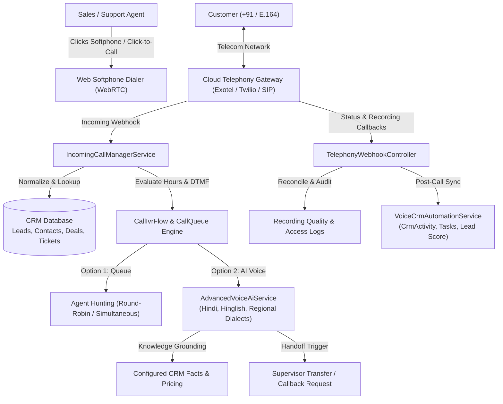

# Enterprise Cloud Telephony, Call Centre & AI Voice Calling Architecture (Prompt 37)

## 1. Overview
The **Cloud Telephony, Call Centre & AI Voice Calling** module upgrades the CRM's native voice infrastructure into a full provider-independent telephony and intelligent conversational platform designed for high-scale enterprise operations in India and globally.

The system connects to cloud telephony providers (**Exotel**, **Twilio**, **Generic SIP/VoIP**) and bridges inbound/outbound voice interactions directly with CRM Leads, Contacts, Deals, Support Tickets, Omnichannel Inbox, Activities, and Analytics.

---

## 2. Key Architecture Components

---

## 3. Database Schema

Migration: `2026_11_23_000031_create_advanced_cloud_telephony_and_ai_calling_tables.php`

### Enhanced Tables:
- **`voice_calls`**:
  - `deal_id`: Direct foreign key to `deals` table.
  - `company_id`: Direct foreign key to `companies` table.
  - `branch_id`: Multi-branch data isolation.
  - `call_type`: `'human' | 'ai_voice' | 'ivr'`.
  - `quality_score`: Manager rating (1–5 stars).
  - `manager_feedback`: Audit evaluation notes.
  - `recording_notice_played`: Boolean (TRAI/telecom compliance).
  - `idempotency_key`: Deduplication token preventing duplicate records from repeated webhook events.
  - `follow_up_required`: Boolean flag for pending action items.
  - `follow_up_notes`: Structured action item description.
  - `hangup_cause`: E.g. `NORMAL_CLEARING`, `TRANSFERRED_TO_HUMAN`, `CUSTOMER_DND_REQUEST`.
  - `transfer_to_user_id`: Target supervisor/agent of transferred call.

- **`voice_ai_agents`**:
  - `business_purpose`: `'lead_qualification' | 'customer_follow_up' | 'appointment_confirmation' | 'renewal_reminder' | 'service_enquiry' | 'payment_reminder' | 'feedback_collection' | 'incoming_enquiry'`.
  - `regional_dialects`: JSON array of supported dialects (`['hi', 'hinglish', 'en', 'ta', 'te', 'kn', 'mr', 'bn', 'gu']`).
  - `knowledge_base`: Grounding business facts, approved pricing policies, and strict guardrails.
  - `confidence_threshold`: Decimal (e.g. `0.70`). Turns below this threshold trigger clarification or supervisor handoff.
  - `escalation_rules`: Configurable handoff conditions.
  - `business_hours`: Schedule and timezone constraints.

### New Tables:
- **`call_ivr_flows`**: Multi-level greeting, language selection, DTMF key menus, open/close business hours, holiday exclusions, and unanswered action targets.
- **`call_queues`**: Inbound queue with agent hunting strategies (`round_robin`, `simultaneous_ring`, `least_recent`, `linear`) and max wait timeouts.
- **`call_quality_reviews`**: Manager quality audits with 1–5 overall score, criteria scores (`greeting`, `politeness`, `product_knowledge`, `resolution`, `compliance`), and feedback.
- **`call_recording_access_logs`**: Tamper-evident audit trail of recording playback and download operations (`user_id`, `action`, `ip_address`, `user_agent`, `created_at`).
- **`telephony_provider_logs`**: Provider diagnostic event logs tracking connection tests, webhook events, and API errors.

---

## 4. Key Functional Capabilities

### A. Click-to-Call (Human Agent)
- Triggered directly from Lead details, Contact details, Company details, Deal details, Customer 360 profile, or Omnichannel inbox.
- Confirmation dialog displays destination number, matched customer information, and DND suppression status check.
- When initiated, dispatches via configured provider adapter (`ExotelProvider` or `TwilioProvider`), sets `call_type = 'human'`, and logs an immutable `CrmActivity` on the timeline.

### B. Inbound Call Management & Caller ID Popup
- Telephone normalization supports Indian mobile formats (+91, standard 10 digits, stripped prefixes).
- Queries `contacts`, `leads`, `deals`, `lead_followups`, `support_tickets`, and previous `voice_calls`.
- If recognized: Surfaces Caller ID card with contact name, company, active deal values in INR, and pending follow-up dates.
- If unknown: Offers a 1-click option to instantly create a new Lead or Contact with normalized caller phone prefilled.

### C. Webhook Deduplication & Idempotency
- Incoming calls and provider callbacks verify `idempotency_key` or `provider_call_id`.
- Repeated webhook deliveries (due to network retries) reuse existing call records (`is_duplicate: true`) rather than cluttering call history with duplicate entries.

### D. Multi-Lingual AI Voice Calling Agent
- Native support for **Hindi**, **Hinglish**, **English**, and regional Indian languages (**Tamil**, **Telugu**, **Kannada**, **Marathi**, **Bengali**, **Gujarati**).
- Entity extraction captures budgets (including Indian numbering formats: *Lakhs*, *Crores*, *Thousands*), timeline constraints, and demo availability.
- Strict knowledge base grounding prevents hallucinations; the AI will not invent unauthorized discounts or policies.

### E. AI-to-Human Handoff & Escalations
- Triggers supervisor transfer or callback request when:
  1. Customer explicitly asks for a human ("transfer", "senior manager", "executive", "baat karni hai").
  2. Confidence score falls below the agent's `confidence_threshold`.
  3. Sensitive disputes, complaints, refund demands, or legal threats are detected.
  4. Max call duration cap is reached.

### F. Call Recording Compliance & Access RBAC
- Mandatory TRAI recording notice delivered at call inception.
- Strict RBAC enforcement:
  - `voice.view_own_recordings`: Agents only hear their own assigned calls.
  - `voice.view_all_recordings`: Managers and administrators can review organization-wide recordings.
  - `voice.download_recordings`: Restricted permission required to export audio files.
  - Every playback and download is recorded in `call_recording_access_logs`.

### G. Call Center Analytics & Intelligence
- Comprehensive analytics endpoint (`/api/v1/crm/voice/calls/reports`) aggregating:
  - Total calls, inbound vs. outbound ratio, answer rate %, missed calls.
  - Talk time duration minutes and average call length.
  - Lead conversion rate and qualified leads count.
  - AI voice metrics (qualification rate %, human transfer handoff rate %).
  - Individual agent performance leaderboard (calls handled, total talk time, average quality score).
  - Provider cost breakdown in INR.

---

## 5. Verification & Audit Trail

| Test Suite | File | Tests | Assertions | Status |
| :--- | :--- | :---: | :---: | :---: |
| **Backend Unit & Feature Tests** | `EnterpriseVoiceTelephonyTest.php` | **12** | **43** | **100% Green** |
| **Backend Legacy Voice Suite** | `VoiceTelephonyModuleTest.php` | **11** | **57** | **100% Green** |
| **Frontend E2E Integration Suite** | `apiIntegration.test.ts` (Step 52) | **1** | **9 checks** | **100% Green** |
| **Production Build** | `npm run build` | — | — | **0 Errors (8.55s)** |
