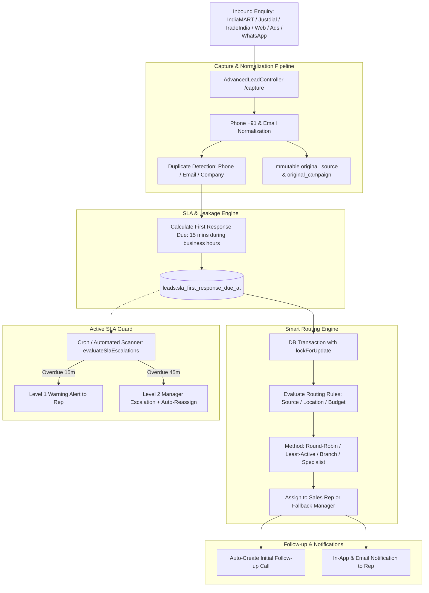

# Advanced Lead Acquisition, Routing & Lead Leakage Prevention Engine

> **Module Documentation:** Indian B2B Portals, Data Normalization, Routing Engine, SLA Escalations, Merging & Lifecycle  
> **CRM Development Prompt:** Prompt 36  
> **Status:** Completed, Verified & Production Ready  
> **Last Updated:** November 23, 2026

---

## 1. Executive Summary & Objective

Indian B2B businesses and high-velocity sales teams face two severe challenges:
1. **Multi-Source Ingestion Fragmentation**: Inquiries originate across various disparate portals (IndiaMART, Justdial, TradeIndia, Facebook/Instagram Lead Ads, Google Ads, website enquiry forms, WhatsApp chats, and inbound phone calls) with inconsistent phone formats and unstructured payloads.
2. **Lead Leakage**: Without strict response-time enforcement, inbound leads often go uncontacted for hours or days. In competitive Indian B2B markets, a lead uncontacted within 15–30 minutes frequently purchases from a competitor.

The **Advanced Lead Management & Leakage Prevention Engine** solves both challenges by extending the existing CRM architecture with:
- **Direct Indian B2B Portal Adapters**: Real-time push API and webhook normalizers for IndiaMART, Justdial, and TradeIndia.
- **E.164 & +91 Phone Normalization**: Strips invalid prefixes, leading zeros, and guarantees clean 10-digit Indian mobile formats.
- **Immutable Source Attribution**: Preserves `original_source` and `original_campaign` regardless of subsequent lifecycle or status transitions.
- **Advanced Routing Engine with Concurrency Lock**: Supports Round-Robin, Least-Active rep balancing, Branch, Territory, and Product routing with atomic database locking to prevent duplicate simultaneous assignments.
- **2-Tier SLA Escalation Engine**: Business-hours aware timers (e.g. 15-minute first response). Triggers Level 1 rep warnings and Level 2 manager alerts with automatic lead reassignment.
- **Formal Duplicate Merge Workflow**: Submits merge requests with master record selection, field conflict overrides, complete timeline re-linking, and audit logs.
- **Complete Lifecycle Stage History**: Tracks every transition with time spent in each stage in seconds.
- **Comprehensive Intelligence & Leakage Dashboard**: Real-time KPI reporting on conversion rates, ageing distribution, rep response times, and SLA breach logs.

---

## 2. Supported Lead Ingestion Sources & Indian B2B Portals

The module provides unified normalization for all 14 acquisition channels:

| Source / Portal | Integration Protocol | Extracted & Normalized Fields |
| :--- | :--- | :--- |
| **IndiaMART** | Push API Webhook (`/portal/indiamart`) | `SENDER_NAME`, `SENDER_MOBILE`, `SENDER_EMAIL`, `GLUSR_USR_COMPANYNAME`, `PRODUCT_NAME`, `QUERY_MESSAGE`, `SENDER_CITY`, `UNIQUE_QUERY_ID` |
| **Justdial** | Lead Capture Webhook (`/portal/justdial`) | `name`, `mobile`, `email`, `category`, `city`, `area`, `pincode`, `leadid` |
| **TradeIndia** | Trade Inquiry API (`/portal/tradeindia`) | `sender_name`, `sender_mobile`, `sender_email`, `sender_co`, `product_name`, `message`, `city`, `inquiry_id` |
| **Website Forms** | Ingestion REST API (`/capture`) | Customer name, phone, email, company, requirement, city, state, postal code, landing page URL |
| **Custom Landing Pages** | Direct Form Embed / API (`/capture`) | Form fields, UTM tags (`utm_source`, `utm_medium`, `utm_campaign`, `utm_term`, `utm_content`) |
| **Facebook Lead Ads** | Meta Graph Webhook Adapter | Full name, phone number, work email, company size, adset ID, campaign ID |
| **Instagram Lead Ads** | Meta Graph Webhook Adapter | Profile name, phone number, product interest, campaign ID |
| **Google Ads** | Webhook Lead Form Asset | GCLID, conversion value, user query, contact info |
| **WhatsApp Enquiries** | WhatsApp Inbound Hook | Sender name, phone, chat snippet, initial inquiry |
| **Live Chat** | Website Chatbot Lead Capture | Visitor name, phone, email, chat transcript |
| **Incoming Phone Calls** | Cloud Telephony (Twilio/Exotel) | Caller CLI, call recording link, IVR department selection |
| **Excel / CSV Imports** | Bulk CSV Import Engine | Bulk record mapping, deduplication check, batch assignment |
| **Referrals** | Referral Capture Interface | Referrer name, client contact, expected deal size |
| **External APIs** | Authenticated Webhook Interface | Custom JSON payload with `X-Lead-Secret` token verification |

---

## 3. Data Normalization & Immutable Attribution

### Indian Phone Normalization (`IndianB2BPortalNormalizer`)
- Automatically strips extraneous non-digit characters (spaces, dashes, brackets).
- Detects Indian mobile patterns (`[6-9]\d{9}`).
- Cleans leading `0` or redundant `91` prefixes.
- Formats to international standard `+91XXXXXXXXXX`.

### Immutable Attribution
- Standard CRM systems often overwrite the lead source when a lead is updated or manually edited.
- This engine introduces `original_source` and `original_campaign` which are populated at initial creation and **never overwritten**, ensuring multi-touch attribution and source ROI remain completely accurate.

---

## 4. Advanced Routing Rules Engine

Configured via `lead_routing_rules` table and managed in the UI.

### Assignment Methods Supported
1. **Round-Robin**: Cycles evenly across a pool of eligible sales reps using an atomic pointer (`last_assigned_index`).
2. **Least-Active Rep**: Calculates open, active leads per rep and assigns the new lead to the representative with the lowest active pipeline count.
3. **Availability & Working Hours**: Assigns only to staff members currently on shift.
4. **Branch-Based**: Matches lead's `branch_id` to branch-specific sales teams.
5. **Location / Territory-Based**: Matches lead's city or state (e.g. Mumbai leads to West Region team).
6. **Product / Specialty-Based**: Routes based on interested product category (e.g. ERP leads to Enterprise Solutions engineers).
7. **Source-Based**: Routes based on origin (e.g. IndiaMART wholesale leads to B2B distributors).
8. **Campaign-Based**: Routes based on marketing campaign identifier.
9. **Fallback Manager**: If all criteria fail or user pools are empty, routes safely to `fallback_user_id` or tenant admin.

### Concurrency Protection
All assignments execute inside a database transaction with `lockForUpdate()` on both the rule and lead records, eliminating race conditions when multiple leads arrive simultaneously from high-volume webhook bursts.

---

## 5. First-Contact SLA & Lead Leakage Prevention Engine

Managed via `lead_sla_policies`, `lead_escalation_logs`, and evaluated by `LeadSlaEngine`.

### SLA Configuration Parameters
- **First Response Deadline**: Default 15 minutes.
- **Follow-up Deadline**: 24 hours.
- **Maximum Idle Period**: 48 hours without contact before escalation.
- **Working Hours Awareness**: Restricts timer countdown to business hours (default: 09:00 to 18:00, Monday to Saturday). Inquiries received at 20:00 start countdown at 09:00 the next business morning.

### Escalation Tiers
- **Tier 1 (Rep Warning)**: When uncontacted lead exceeds `escalation_level_1_minutes` (e.g. 15 mins overdue), marks `sla_status = 'breached'`, logs `LeadEscalationLog`, and sends urgent notifications to the assigned representative.
- **Tier 2 (Manager Escalation & Auto-Reassignment)**: When uncontacted lead exceeds `escalation_level_2_minutes` (e.g. 45 mins overdue), marks `sla_status = 'escalated'`, alerts the sales manager, and automatically reassigns lead to `manager_user_id` to prevent deal loss.

### First Response Logging
- When an employee calls, sends a WhatsApp message, logs an email, or advances status to `contacted`, `sla_first_responded_at` is stamped.
- Turnaround time is computed in minutes and verified against the due date to categorize as `within_sla` or `breached`.

---

## 6. Duplicate Lead Detection & Formal Merge Workflow

### Matching Heuristics
- Exact or partial phone match (normalized)
- Exact email match (case-insensitive)
- Company name fuzzy match
- External Lead ID match

### Formal Merge Request Workflow
To ensure sales reps do not accidentally destroy historical customer communications:
1. Sales reps submit a **Lead Merge Request** specifying the `master_lead_id`, `duplicate_lead_id`, and `field_overrides`.
2. Stored in `lead_merge_requests` with status `pending`.
3. An authorized manager reviews both profiles side-by-side in the CRM.
4. On **Approval**:
   - Master lead fields are updated with chosen overrides.
   - All child records (`crm_activities`, `lead_followups`, `lead_assignments`, `lead_stage_histories`, `lead_ingestion_events`, `media_files`) are atomically re-linked to the master lead.
   - Tags are merged.
   - Duplicate lead is soft-deleted with an audit trail note.
   - Full pre-merge snapshot is archived in `duplicate_merge_logs`.

---

## 7. Complete Lifecycle Stages & Duration Tracking

Stages: `new`, `uncontacted`, `contacted`, `qualified`, `meeting_scheduled`, `proposal_sent`, `negotiation`, `converted`, `lost`, `recycled` + custom stages.

- **Duration Auditing**: Each transition logs `time_in_previous_stage_seconds` in `lead_stage_histories`.
- **Lost Reason Enforcement**: Transitioning to `lost` requires an explicit reason (e.g. "Competitor price", "Feature mismatch", "Budget canceled").
- **Recycling Engine**: Transitioning to `recycled` schedules an automatic re-engagement touchpoint in 30 days.

---

## 8. Follow-up Management & Overdue Monitoring

- **Types**: Phone Call, WhatsApp, Email, In-Person/Video Meeting, Task Reminder.
- **Outcomes**: `connected`, `busy`, `no_answer`, `interested`, `callback_requested`, `not_interested`, `meeting_scheduled`.
- **Rescheduling**: Links previous follow-up to new scheduled date with reason.
- **Overdue Monitoring**: Immediate filtering of pending follow-ups past their scheduled time.

---

## 9. Lead Conversion Engine

Authorized users with `leads.convert` permission can convert a qualified lead into:
1. **Contact**: Automatic deduplication against existing contacts by phone and email.
2. **Company**: Links existing company or creates new corporate account.
3. **Deal / Opportunity**: Configured with pipeline, stage, and deal value.
4. **Customer 360 Account**: Links contact and company under customer account.
5. **Project**: Optional creation of an onboarding project linked to the client.

---

## 10. Database Schema (New & Extended Tables)

Migration: `2026_11_23_000030_create_advanced_lead_management_and_leakage_tables.php`

| Table Name | Description | Key Columns |
| :--- | :--- | :--- |
| `leads` (Extended) | Extended core lead entity | `branch_id`, `original_source`, `original_campaign`, `external_lead_id`, `custom_fields_payload`, `last_contacted_at`, `sla_policy_id`, `sla_first_response_due_at`, `sla_first_responded_at`, `sla_status`, `sla_escalated_at`, `reassigned_count` |
| `lead_routing_rules` | Smart routing balancer definitions | `tenant_id`, `name`, `priority`, `is_active`, `conditions`, `assignment_method`, `target_user_ids`, `fallback_user_id`, `last_assigned_index` |
| `lead_sla_policies` | First response & idle SLA policies | `tenant_id`, `name`, `first_response_time_minutes`, `working_hours_only`, `business_hours_start`, `business_hours_end`, `escalation_level_1_minutes`, `escalation_level_2_minutes`, `manager_user_id` |
| `lead_escalation_logs` | SLA breach & leakage audit trail | `tenant_id`, `lead_id`, `sla_policy_id`, `escalation_level`, `reason`, `action_taken`, `previous_user_id`, `new_user_id`, `triggered_at` |
| `lead_stage_histories` | Stage progression duration logs | `tenant_id`, `lead_id`, `user_id`, `from_stage`, `to_stage`, `time_in_previous_stage_seconds`, `reason`, `notes` |
| `lead_followups` | Follow-up schedule & outcome ledger | `tenant_id`, `lead_id`, `assigned_user_id`, `followup_type`, `scheduled_at`, `status`, `outcome`, `completed_at`, `rescheduled_to_id` |
| `lead_scoring_configurations` | Tenant scoring weights & thresholds | `tenant_id`, `hot_threshold`, `warm_threshold`, `weights`, `is_active` |
| `lead_merge_requests` | Formal duplicate merge approvals | `tenant_id`, `master_lead_id`, `duplicate_lead_id`, `status`, `requested_by_user_id`, `approved_by_user_id`, `field_overrides` |
| `lead_portal_integrations` | IndiaMART, Justdial, TradeIndia configs | `tenant_id`, `portal`, `name`, `api_key`, `webhook_secret`, `is_active`, `total_captured_count`, `last_sync_at` |

---

## 11. REST API Reference

All endpoints are registered under `/api/v1/crm/leads/*`:

| Method | Endpoint | Description | Permission Required |
| :---: | :--- | :--- | :--- |
| `POST` | `/capture` | Universal lead capture with +91 normalization & duplicate check | `leads.create` (or public) |
| `POST` | `/portal/{portal}` | IndiaMART, Justdial, TradeIndia webhook ingestion | Secret / API key |
| `GET` | `/portals` | List configured portal integrations | `leads.manage_settings` |
| `POST` | `/portals` | Save or toggle portal integration | `leads.manage_settings` |
| `GET` | `/routing/rules` | List lead routing rules | `leads.manage_settings` |
| `POST` | `/routing/rules` | Create or update routing rule | `leads.manage_settings` |
| `DELETE`| `/routing/rules/{id}` | Delete routing rule | `leads.manage_settings` |
| `POST` | `/{lead}/auto-route` | Trigger routing engine on lead | `leads.assign` |
| `GET` | `/sla/policies` | List SLA policies | `leads.manage_settings` |
| `POST` | `/sla/policies` | Create or update SLA policy | `leads.manage_settings` |
| `POST` | `/sla/evaluate` | Trigger SLA breach scanner & escalations | `leads.manage_settings` |
| `GET` | `/sla/escalations` | List SLA escalation audit logs | `leads.view_reports` |
| `POST` | `/{lead}/record-response`| Stamp first response & evaluate SLA compliance | `leads.edit` |
| `GET` | `/followups/overdue` | List overdue follow-ups | `leads.view` |
| `GET` | `/{lead}/followups` | List scheduled follow-ups for a lead | `leads.view` |
| `POST` | `/{lead}/followups` | Schedule new follow-up touchpoint | `leads.edit` |
| `POST` | `/followups/{id}/complete` | Complete follow-up with outcome | `leads.edit` |
| `POST` | `/followups/{id}/reschedule`| Reschedule follow-up with reason | `leads.edit` |
| `POST` | `/{lead}/transition-stage`| Advance lifecycle stage with duration tracking | `leads.edit` |
| `GET` | `/{lead}/stage-history` | View stage history audit trail | `leads.view` |
| `GET` | `/merge-requests` | List duplicate merge requests | `leads.view` |
| `POST` | `/merge-requests` | Submit merge request with field overrides | `leads.edit` |
| `POST` | `/merge-requests/{id}/approve` | Approve and execute deep duplicate merge | `leads.approve` |
| `POST` | `/merge-requests/{id}/reject` | Reject duplicate merge request | `leads.reject` |
| `GET` | `/scoring/config` | Get scoring thresholds (Hot/Warm/Cold) | `leads.manage_settings` |
| `POST` | `/scoring/config` | Update scoring weights & thresholds | `leads.manage_settings` |
| `POST` | `/{lead}/convert` | Convert lead into Contact, Company, Deal & Project | `leads.convert` |
| `GET` | `/reports/dashboard` | Complete intelligence, attribution & leakage analytics | `leads.view_reports` |

---

## 12. Granular RBAC Permissions

Enforced strictly via `RbacService` and row-level data scoping:
- `leads.view_all`, `leads.view_own`, `leads.view_assigned`, `leads.view_team`, `leads.view_branch`
- `leads.create`, `leads.edit`, `leads.delete`, `leads.import`, `leads.export`
- `leads.assign`, `leads.reassign`, `leads.convert`
- `leads.approve`, `leads.reject` (duplicate merge approval)
- `leads.manage_settings` (routing rules, SLA policies, portal keys)
- `leads.view_reports` (performance dashboard, leakage logs)

---

## 13. Verification & Test Results

### Backend Automated Test Suite
- **Test File**: `backend/tests/Feature/EnterpriseLeadManagementTest.php`
- **Result**: **12 passed (89 assertions), 100% green**
- **Test Cases Covered**:
  1. `test_multi_source_lead_capture_and_phone_normalization`
  2. `test_indiamart_and_justdial_portal_ingestion`
  3. `test_duplicate_detection_and_formal_merge_approval`
  4. `test_routing_rules_engine_and_least_active_assignment`
  5. `test_sla_calculation_and_escalation_tiers`
  6. `test_first_response_logging_and_compliance`
  7. `test_lifecycle_stage_transitions_and_history`
  8. `test_followup_scheduling_and_completion`
  9. `test_lead_conversion_with_contact_deduplication`
  10. `test_lead_performance_and_leakage_reports`
  11. `test_granular_rbac_permission_enforcement`
  12. `test_strict_cross_tenant_isolation_on_leads_and_routing`

### Full Frontend-to-Backend Integration Suite
- **Command**: `cd frontend; npm.cmd run test:integration`
- **Result**: **51 passed, 0 failed** (Steps 1–51 verified end-to-end)
- **Step 51 Verified**:
  - Multi-source capture with phone normalization (+91)
  - IndiaMART BuyLeads webhook ingestion
  - Routing rules API
  - SLA policy configuration
  - Follow-up scheduling
  - Lifecycle stage transition
  - Performance & leakage reporting reconciliation

### Production Build Verification
- **Command**: `cd frontend; npm.cmd run build`
- **Result**: Built cleanly in 8.41s with 0 errors.
