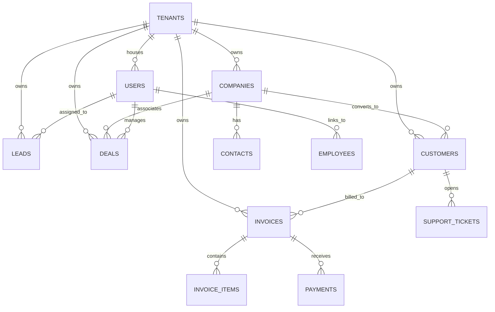

# Database Mapping & Migration Blueprint: JSON to MySQL

**Date**: November 2026  
**Source Data**: `frontend/crm_db.json` (21 Collections, 51+ seed records)  
**Target Engine**: MySQL 8.0+ / InnoDB with UTF8MB4 charset, strict foreign keys, indexes, and multi-tenant isolation.

---

## 1. Migration Strategy & Multi-Tenant Design

The current system stores data in a flat JSON structure using client-generated or timestamp-based string IDs (`usr-john`, `lead-1`, `comp-1`). In the target production architecture:

1. **Multi-Tenancy Isolation**:
   - Every tenant is represented in a `tenants` table.
   - All tenant-owned tables include a `tenant_id` column (indexed, constrained to `tenants.id` on delete cascade).
   - Global scopes in Laravel Eloquent models (`TenantScope`) automatically enforce `WHERE tenant_id = ?` on every select, insert, update, and delete.
2. **Primary & Foreign Keys**:
   - Primary Keys: BigInteger Auto-Increment (`id`) for high-performance indexing, alongside a public `uuid` (CHAR(36)) for API exposure to prevent sequential ID scraping.
3. **Auditability**:
   - All tables include `created_at`, `updated_at`, and `deleted_at` (`softDeletes()`).
4. **Relational Normalization**:
   - Embedded arrays in JSON (e.g. `items` inside `quotations` and `invoices`, `teamMembers` inside `projects`, `attendees` inside `meetings`) are normalized into relational child tables.

---

## 2. Entity-by-Entity Schema Mapping

### 2.1 Tenants Table (`tenants`) - *New Multi-Tenant Foundation*
| Field | Target MySQL Column | Data Type | Modifiers / Constraints |
|---|---|---|---|
| Tenant ID | `id` | BIGINT UNSIGNED | PK, Auto-Increment |
| UUID | `uuid` | CHAR(36) | Unique, Indexed |
| Organization Name | `name` | VARCHAR(255) | NOT NULL |
| Subdomain / Slug | `slug` | VARCHAR(100) | Unique, Indexed |
| Plan / Tier | `subscription_tier` | ENUM('starter', 'pro', 'enterprise') | Default: 'starter' |
| Status | `status` | ENUM('active', 'trialing', 'past_due', 'suspended') | Default: 'trialing' |
| Timestamps | `created_at`, `updated_at` | TIMESTAMP | Nullable |

---

### 2.2 Users Table (`users`)
**Source JSON**: `users` (9 records)
| JSON Field | Target MySQL Column | Data Type | Notes & Foreign Keys |
|---|---|---|---|
| `id` | `legacy_id` / `uuid` | VARCHAR(50) / CHAR(36) | Maps legacy `usr-john` for migration matching |
| (auto) | `id` | BIGINT UNSIGNED | Primary Key |
| (tenant) | `tenant_id` | BIGINT UNSIGNED | FK -> `tenants.id` |
| `name` | `name` | VARCHAR(255) | NOT NULL |
| `email` | `email` | VARCHAR(255) | Unique per tenant |
| `passwordHash` | `password` | VARCHAR(255) | Migrated to bcrypt / argon2id |
| `avatar` | `avatar` | VARCHAR(500) | Nullable |
| `status` | `status` | ENUM('active', 'inactive') | Default: 'active' |
| `department` | `department` | VARCHAR(100) | Nullable |
| `twoFactorEnabled` | `two_factor_enabled` | BOOLEAN | Default: FALSE |
| (new) | `two_factor_secret` | VARCHAR(255) | Nullable (for TOTP) |
| `lastActive` | `last_active_at` | TIMESTAMP | Nullable |
| `createdAt` | `created_at` | TIMESTAMP | Preserves JSON creation timestamp |

---

### 2.3 Companies Table (`companies`)
**Source JSON**: `companies` (4 records)
| JSON Field | Target MySQL Column | Data Type | Notes & Foreign Keys |
|---|---|---|---|
| `id` | `id` | BIGINT UNSIGNED | PK (Indexed) |
| `name` | `name` | VARCHAR(255) | NOT NULL |
| `industry` | `industry` | VARCHAR(100) | Nullable |
| `website` | `website` | VARCHAR(255) | Nullable |
| `size` | `size` | VARCHAR(50) | e.g. "11-50", "200+" |
| `revenue` | `annual_revenue` | DECIMAL(15, 2) | Normalized from string "$5M" to numeric `5000000.00` |
| `address` | `address` | TEXT | Nullable |
| `phone` | `phone` | VARCHAR(50) | Nullable |
| `createdAt` | `created_at` | TIMESTAMP | Preserved |

---

### 2.4 Leads Table (`leads`)
**Source JSON**: `leads` (5 records)
| JSON Field | Target MySQL Column | Data Type | Notes & Foreign Keys |
|---|---|---|---|
| `id` | `id` | BIGINT UNSIGNED | PK |
| (tenant) | `tenant_id` | BIGINT UNSIGNED | FK -> `tenants.id` |
| `name` | `name` | VARCHAR(255) | Contact name |
| `company` | `company_name` | VARCHAR(255) | Optional company text |
| (relation) | `company_id` | BIGINT UNSIGNED | Nullable, FK -> `companies.id` |
| `email` | `email` | VARCHAR(255) | Indexed |
| `phone` | `phone` | VARCHAR(50) | Nullable |
| `value` | `estimated_value` | DECIMAL(15, 2) | Default: 0.00 |
| `status` | `status` | ENUM('new', 'contacted', 'qualified', 'lost') | Default: 'new' |
| `source` | `source` | VARCHAR(100) | e.g. 'Inbound', 'Cold Email' |
| `assignedTo` | `assigned_user_id` | BIGINT UNSIGNED | Nullable, FK -> `users.id` |
| `notes` | `notes` | TEXT | Nullable |
| `createdAt` | `created_at` | TIMESTAMP | Preserved |

---

### 2.5 Deals Table (`deals`)
**Source JSON**: `deals` (4 records)
| JSON Field | Target MySQL Column | Data Type | Notes & Foreign Keys |
|---|---|---|---|
| `id` | `id` | BIGINT UNSIGNED | PK |
| `name` | `name` | VARCHAR(255) | Deal title |
| `companyId` | `company_id` | BIGINT UNSIGNED | FK -> `companies.id` |
| `value` | `value` | DECIMAL(15, 2) | Deal total |
| `stage` | `stage` | ENUM('qualification', 'proposal', 'negotiation', 'won', 'lost') | Indexed |
| `probability` | `probability` | TINYINT UNSIGNED | 0 to 100 percentage |
| `closeDate` | `close_date` | DATE | Expected win date |
| `assignedTo` | `assigned_user_id` | BIGINT UNSIGNED | FK -> `users.id` |
| `createdAt` | `created_at` | TIMESTAMP | Preserved |

---

### 2.6 Customers Table (`customers`)
**Source JSON**: `customers` (3 records)
| JSON Field | Target MySQL Column | Data Type | Notes & Foreign Keys |
|---|---|---|---|
| `id` | `id` | BIGINT UNSIGNED | PK |
| `name` | `name` | VARCHAR(255) | Customer Name |
| `companyId` | `company_id` | BIGINT UNSIGNED | FK -> `companies.id` |
| `email` | `email` | VARCHAR(255) | Indexed |
| `phone` | `phone` | VARCHAR(50) | Nullable |
| `status` | `status` | ENUM('active', 'inactive') | Default: 'active' |
| `assignedTo` | `assigned_user_id` | BIGINT UNSIGNED | FK -> `users.id` |
| `createdAt` | `created_at` | TIMESTAMP | Preserved |

---

### 2.7 Contacts Table (`contacts`)
**Source JSON**: `contacts` (3 records)
| JSON Field | Target MySQL Column | Data Type | Notes & Foreign Keys |
|---|---|---|---|
| `id` | `id` | BIGINT UNSIGNED | PK |
| `name` | `name` | VARCHAR(255) | Contact Name |
| `companyId` | `company_id` | BIGINT UNSIGNED | FK -> `companies.id` |
| `email` | `email` | VARCHAR(255) | Contact Email |
| `phone` | `phone` | VARCHAR(50) | Phone number |
| `role` | `job_title` | VARCHAR(100) | Contact's role in the company |
| `isPrimary` | `is_primary` | BOOLEAN | Default: FALSE |
| `createdAt` | `created_at` | TIMESTAMP | Preserved |

---

### 2.8 Products & Services Tables (`products`, `services`)
**Source JSON**: `products` (3 records), `services` (2 records)
- `products`: `id`, `name`, `sku` (Unique), `price` (DECIMAL), `category`, `status`, `description`.
- `services`: `id`, `name`, `billing_cycle` (ENUM 'monthly', 'yearly', 'one-time'), `price` (DECIMAL), `category`, `status`, `description`.

---

### 2.9 Quotations & Invoices Tables with Line Items
**Source JSON**: `quotations` (2 records), `invoices` (3 records)
- Normalized into 4 tables:
  1. `quotations` (`id`, `quote_number` UNIQUE, `deal_id`, `customer_id`, `subtotal`, `tax_rate`, `tax_amount`, `total_amount`, `status`, `valid_until`, `created_at`).
  2. `quotation_items` (`id`, `quotation_id` FK, `item_name`, `quantity`, `unit_price`, `total_price`).
  3. `invoices` (`id`, `invoice_number` UNIQUE, `customer_id` FK, `subtotal`, `tax_rate`, `tax_amount`, `total_amount`, `status`, `due_date`, `created_at`).
  4. `invoice_items` (`id`, `invoice_id` FK, `item_name`, `quantity`, `unit_price`, `total_price`).

---

### 2.10 Payments Table (`payments`)
**Source JSON**: `payments` (1 record)
| JSON Field | Target MySQL Column | Data Type | Notes & Foreign Keys |
|---|---|---|---|
| `id` | `id` | BIGINT UNSIGNED | PK |
| `invoiceId` | `invoice_id` | BIGINT UNSIGNED | FK -> `invoices.id` |
| `amount` | `amount` | DECIMAL(15, 2) | Amount paid |
| `method` | `payment_method` | ENUM('Credit Card', 'Bank Transfer', 'PayPal', 'Stripe', 'Check') | |
| `status` | `status` | ENUM('success', 'failed', 'pending') | |
| `paymentDate` | `paid_at` | TIMESTAMP | Payment execution time |

---

### 2.11 Projects & Tasks Tables (`projects`, `tasks`, `project_members`)
**Source JSON**: `projects` (2 records), `tasks` (3 records)
- `projects`: `id`, `name`, `customer_id` FK, `status` (ENUM 'not_started', 'in_progress', 'completed', 'on_hold'), `start_date`, `end_date`, `progress` (TINYINT 0-100).
- `project_members`: Pivot table `project_id` and `user_id`.
- `tasks`: `id`, `project_id` Nullable FK, `title`, `description`, `priority` (ENUM 'low', 'medium', 'high'), `status` (ENUM 'todo', 'in_progress', 'done'), `assigned_user_id` FK, `due_date`.

---

### 2.12 HR Suite: Employees, Attendance & Leaves
**Source JSON**: `employees` (3 records), `attendance` (3 records), `leaves` (2 records)
- `employees`: `id`, `user_id` Nullable FK, `name`, `email`, `department`, `designation`, `date_of_joining`, `salary` (DECIMAL), `status` (ENUM 'active', 'suspended', 'terminated').
- `attendances`: `id`, `employee_id` FK, `date` (DATE), `check_in` (TIME), `check_out` (TIME Nullable), `status` (ENUM 'present', 'absent', 'late', 'leave').
- `leaves`: `id`, `employee_id` FK, `type` (ENUM 'Casual', 'Sick', 'Unpaid', 'Maternity', 'Paternity'), `start_date`, `end_date`, `status` (ENUM 'pending', 'approved', 'rejected'), `reason`, `approved_by_user_id` Nullable FK.

---

### 2.13 Support Helpdesk: Tickets (`support_tickets`)
**Source JSON**: `tickets` (2 records)
- `support_tickets`: `id`, `customer_id` FK, `subject`, `description`, `priority` (ENUM 'low', 'medium', 'high'), `status` (ENUM 'open', 'in_progress', 'resolved', 'closed'), `assigned_user_id` FK, `created_at`.

---

### 2.14 Security & System Utilities: Activity Logs, Notifications & Settings
- `activity_logs`: `id`, `user_id` FK, `action`, `module`, `details`, `ip_address`, `user_agent`, `created_at`.
- `notifications`: `id`, `user_id` FK, `title`, `message`, `is_read` (BOOLEAN), `read_at` (TIMESTAMP Nullable).
- `system_settings`: `id`, `tenant_id` FK Unique, `company_name`, `company_email`, `company_phone`, `tax_rate`, `currency`, `theme`.

---

## 3. Data Migration Script Blueprint

A dedicated Laravel Artisan migration command will parse `frontend/crm_db.json` and populate the MySQL database while preserving relationships:

1. **Step 1 - Tenant Creation**: Creates the default tenant (`Acme Enterprise Inc.`).
2. **Step 2 - Users & Roles**: Seeds Spatie roles (`Super Admin`, `Admin`, etc.), inserts users, hashes passwords with bcrypt, maps legacy string IDs (`usr-john` -> numeric PK), and assigns roles.
3. **Step 3 - Core Entities**: Inserts companies, contacts, customers, products, services.
4. **Step 4 - Relational Records**: Inserts leads, deals, projects, tasks, meetings, employees.
5. **Step 5 - Sales & Invoicing**: Inserts quotations and invoices with normalized child rows in `quotation_items` and `invoice_items`.
6. **Step 6 - Logs & Settings**: Inserts activity logs, notifications, and tenant settings.
