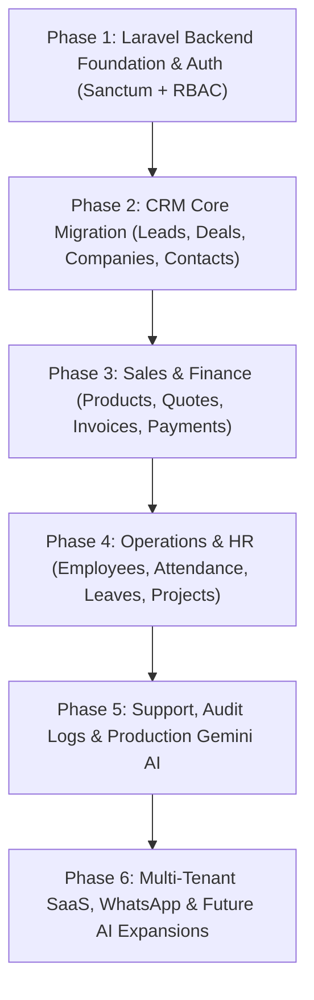

# Module Implementation Roadmap & Feature Mapping

**Date**: November 2026  
**Scope**: Transition from Express/JSON to Laravel 12 Enterprise Multi-Tenant AI CRM SaaS  
**Guiding Principle**: Preserve 100% of existing UI capabilities while elevating data integrity, security, and scalability.

---

## 1. Existing Feature to Future Module Mapping

| Existing Feature / Screen | Current File / Location | Target Laravel Module | Future SaaS Capabilities & Extensions |
|---|---|---|---|
| **User Sign-In & 2FA** | `App.tsx`, `server.ts` | `Modules/Auth` | Real TOTP Google Authenticator, Email OTP, WebAuthn / Passkeys |
| **User Roles & Access** | `ModulesView.tsx`, `types.ts` | `Modules/AccessControl` | Spatie Laravel Permission, Dynamic Role Builder, Granular Field-Level Permissions |
| **Leads & Kanban** | `ModulesView.tsx`, `crm_db.json` | `Modules/Leads` | Lead Acquisition Forms, Webhooks, WhatsApp Lead Capture, AI Lead Enrichment |
| **Deals & Pipeline** | `ModulesView.tsx`, `crm_db.json` | `Modules/Deals` | Multiple Custom Pipelines, Weighted Forecasting, Automated Stage Triggers |
| **Companies & Contacts**| `ModulesView.tsx`, `crm_db.json` | `Modules/CRM` | Company Enrichment API (Clearbit/Apollo), Hierarchical Org Charts, Deduplication |
| **Products & Services** | `ModulesView.tsx`, `crm_db.json` | `Modules/Catalog` | Multi-currency pricing, recurring billing intervals, inventory stock tracking |
| **Quotations & Invoices**| `ModulesView.tsx`, `exportUtils.ts` | `Modules/Billing` | Automated PDF email delivery, Razorpay/Stripe checkout links, e-Invoicing compliance |
| **Payments** | `ModulesView.tsx`, `crm_db.json` | `Modules/Billing` | Automated Stripe Webhooks, Partial Payments, Credit Notes, Subscription Invoicing |
| **Projects & Tasks** | `ModulesView.tsx`, `crm_db.json` | `Modules/Projects` | Gantt Charts, Time Tracking, Milestone billing, Task Dependencies |
| **Meetings Calendar** | `ModulesView.tsx`, `crm_db.json` | `Modules/Calendar` | Google Calendar / Outlook 2-way sync, Zoom/Meet automated link generation |
| **Staff Roster & HR** | `ModulesView.tsx`, `crm_db.json` | `Modules/HR` | Employee Onboarding workflows, Salary slips, Document management |
| **Attendance & Clocking**| `Layout.tsx`, `server.ts` | `Modules/HR` | Geo-fenced mobile clock-in, biometric integration, automated overtime calculation |
| **Leaves Management** | `ModulesView.tsx`, `server.ts` | `Modules/HR` | Multi-level approval hierarchies, leave balance tracking, holiday calendar |
| **Support Helpdesk** | `ModulesView.tsx`, `server.ts` | `Modules/Helpdesk` | Multi-channel ticketing (Email, WhatsApp, Web widget), SLA escalations |
| **AI Draft Replies** | `server.ts`, `ModulesView.tsx` | `Modules/AI` | Unified LLM Orchestrator (Gemini 2.5/3.5, OpenAI), fine-tuned domain knowledge vectors |
| **Audit Logs & Security**| `ModulesView.tsx`, `server.ts` | `Modules/Audit` | Immutable tamper-proof activity logs, login anomaly detection, exportable audit trail |
| **System Settings** | `ModulesView.tsx`, `crm_db.json` | `Modules/Settings` | White-label branding, custom domain mapping, SMTP configuration, API keys |
| **Future: WhatsApp CRM** | *New* | `Modules/WhatsApp` | WhatsApp Business API, automated templates, bulk broadcast, conversational inbox |
| **Future: AI Calling** | *New* | `Modules/AICalling` | Automated outbound qualification calls, voice agent synthesis, call transcription |
| **Future: Unified Inbox**| *New* | `Modules/Inbox` | Omnichannel inbox (WhatsApp, Email, SMS, Instagram DM, Website Chat) |
| **Future: Workflows** | *New* | `Modules/Automation` | Visual Drag-and-Drop Node Automation Builder (Triggers, Conditions, Actions) |
| **Future: Landing Pages**| *New* | `Modules/PageBuilder` | Drag-and-drop block page builder with integrated lead capture forms |
| **Future: Super Admin** | *New* | `Modules/SuperAdmin` | SaaS Tenant Management, MRR analytics, license provisioning, system health |

---

## 2. Six-Phase Implementation Roadmap

### Phase 1: Laravel Backend Foundation & Auth (Days 1–3)
- **Objectives**:
  1. Initialize `api.php` in Laravel 12 using `php artisan install:api`.
  2. Install and configure **Laravel Sanctum** for token-based authentication.
  3. Install and configure **Spatie Laravel Permission** for the 8 system roles.
  4. Create `tenants` migration, model, and `TenantScope`.
  5. Create `AuthController` (`login`, `register`, `verify-2fa`, `profile`, `logout`).
  6. Migrate all existing `users` from `crm_db.json` into MySQL with hashed passwords.
  7. Connect React frontend to Laravel Auth API via Vite proxy.

### Phase 2: CRM Core Migration (Days 4–7)
- **Objectives**:
  1. Create migrations and models for `companies`, `contacts`, `customers`, `leads`, `deals`.
  2. Create standard Eloquent resource controllers with FormRequest validation.
  3. Build migration seeder parsing legacy data from `crm_db.json`.
  4. Fix UI bug in `ModuleModals.tsx`: Add missing form fields for `contacts`.
  5. Verify Leads Kanban view, Deals Pipeline view, and table sorting/filtering with live MySQL data.

### Phase 3: Sales, Invoicing & Finance Engine (Days 8–11)
- **Objectives**:
  1. Create migrations for `products`, `services`, `quotations`, `quotation_items`, `invoices`, `invoice_items`, `payments`.
  2. Implement `QuotationController`, `InvoiceController`, `PaymentController`.
  3. Fix UI bug in `ModuleModals.tsx`: Add missing modal forms for `quotations`, `services`, and `payments`.
  4. Integrate server-side PDF invoice generation or stream data to existing `jsPDF` pipeline.
  5. Validate automated status recalculations (e.g. marking invoice as `paid` upon payment recording).

### Phase 4: Operations, HR & Project Management (Days 12–15)
- **Objectives**:
  1. Create migrations for `employees`, `attendances`, `leaves`, `projects`, `tasks`, `meetings`.
  2. Implement attendance clock-in / clock-out logic with IP logging.
  3. Implement leave approval workflow (`/api/v1/crm/leaves/{id}/approve`) with email notifications.
  4. Implement Projects and Tasks controllers with team assignment pivots.
  5. Connect frontend HR tabs and Attendance buttons to the new Laravel endpoints.

### Phase 5: Support Helpdesk, Audit Logs & AI Co-Pilot (Days 16–18)
- **Objectives**:
  1. Create migrations for `support_tickets`, `activity_logs`, `notifications`, `system_settings`.
  2. Implement `AuditLoggerMiddleware` recording mutating API calls directly to `activity_logs`.
  3. Build Laravel AI Service wrapping Google Gemini API via background queued jobs (`dispatch(new AnalyzeLeadJob($leadId))`).
  4. Return cached AI insights via REST endpoints to replace frontend direct polling.
  5. Validate complete feature parity with legacy Express server.

### Phase 6: Multi-Tenant SaaS & Future Extensions (Days 19–30+)
- **Objectives**:
  1. Activate subdomain/domain tenant resolution (`tenant1.acmecrm.io`).
  2. Build separate **Super Admin Portal** for managing SaaS subscriptions, tenants, and MRR.
  3. Integrate **WhatsApp Business Cloud API** for real-time messaging and lead capture.
  4. Build **Unified Inbox** aggregating WhatsApp, Email, and web chat.
  5. Implement **Visual Workflow Builder** (event-driven triggers and queued actions).
  6. Deploy **Stripe / Razorpay Billing** with automated recurring invoicing and webhook handling.
