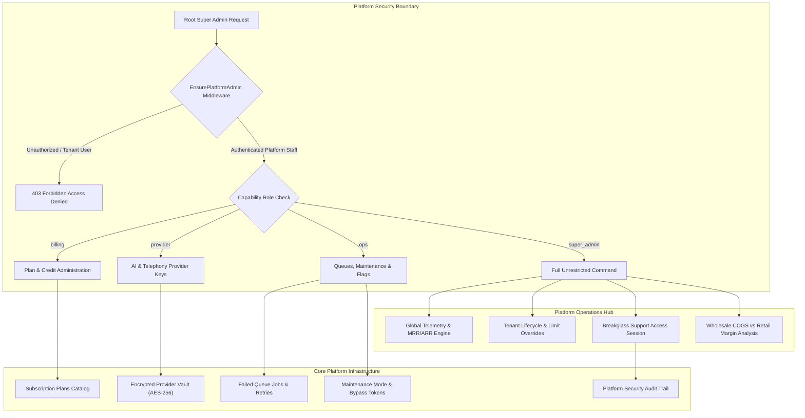

# Dedicated Platform Super Admin Console

## 1. Overview & Architecture

The **Platform Super Admin Console** is an isolated, platform-level governance and operational control plane. It is **completely distinct from business tenant admin dashboards**, operating under a dedicated security boundary (`platform.admin` middleware) to govern all tenants, subscriptions, wholesale provider costs, model routing policies, background queues, and system health.

---

## 2. Platform Telemetry & Revenue Metrics

The console computes true, real-time, cross-tenant business intelligence metrics:

| Metric Category | Metrics Computed | Calculation Formula / Source |
| :--- | :--- | :--- |
| **Tenant Population** | Registered Businesses, Active, Trial, Suspended, Cancelled | `Tenant::count()`, breakdown by status |
| **Recurring Revenue** | Monthly Recurring Revenue (MRR), Annual Run Rate (ARR) | $\text{MRR} = \sum \text{Monthly Price} + \frac{\sum \text{Annual Price}}{12}$ |
| **Cash Collections** | Total Invoiced + Total Credit Top-ups | $\sum \text{Paid Invoices} + \sum \text{Credit Recharges}$ |
| **Gross Margin Analysis** | Retail Charges Billed, Wholesale Provider COGS, Margin % | $\text{Gross Profit} = \text{Retail Billed} - \text{Provider Wholesale Cost}$ |
| **Consumption Volumes**| LLM Tokens, AI Voice Minutes, WhatsApp Messages, SMS, Emails | Aggregate units from `usage_records` across all tenants |
| **System Health** | MySQL Core, Redis Cache, Storage, Failed Jobs, Integrations | Live ping, latency checks, and failed queue job counts |

---

## 3. Multi-Tenant Governance & Breakglass Support Access

### Tenant Lifecycle Controls
Platform Super Admins can search and filter the global tenant directory and perform lifecycle actions:
- **Activate / Suspend / Restore / Cancel**: Requires a mandatory audit justification string, logs to `platform_audit_logs`, and cascades subscription state updates.
- **Plan Modifications**: Change tenant tier with optional proration credits.
- **Platform Limit Overrides**: Custom overrides for seat limits, token allowances, WhatsApp channels, and workflow limits directly stored in tenant settings.

### Restricted Support Protocol (Breakglass Impersonation)
Casual browsing of customer tenant data by platform personnel is **strictly prohibited**.
1. **Mandatory Justification**: Support staff must supply a valid support ticket or incident reference (e.g., `INC-8942`).
2. **Expiring Token**: Issues a time-bound session token (default 60 minutes) recorded in `platform_support_access_logs`.
3. **Audit Trail**: Initiating and revoking support access creates immutable records in `platform_audit_logs`.

---

## 4. Commercial Plan & Billing Administration

- **Subscription Plans Catalog**: Create, update, and archive commercial pricing tiers (Starter, Professional, Enterprise, Custom).
- **Dynamic Limits & Rates**: Set monthly/annual prices, included allowances (tokens, calling mins, SMS, emails), overage rates, seat limits, and trial rules.
- **Global Invoices & Subscriptions**: Real-time cross-tenant visibility into all issued invoices, payment statuses, and renewal periods.
- **Manual Credit Adjustments**: Controlled platform credits or debits to tenant wallets with mandatory audit reasons logged in both `credit_ledger_entries` and `platform_audit_logs`.

---

## 5. AI & Infrastructure Provider Administration

The platform adapter engine decouples business tenants from upstream AI and telephony infrastructure:

- **Supported Providers**: Google Gemini AI, OpenAI, Anthropic Claude, ElevenLabs, Exotel, Twilio, and Meta WhatsApp Cloud API.
- **Cryptographic Encryption at Rest**: Provider API keys and credentials are encrypted using Laravel's AES-256-CBC cipher (`encrypted_credentials`). Plaintext secrets are **never returned in API responses**.
- **Model Routing Policies**: Dynamic default model selection, fallback chains (e.g., primary: Gemini 2.0 Flash $\rightarrow$ fallback: OpenAI GPT-4o), and rate limits (RPM / TPM).
- **Live Health Diagnostics**: On-demand ping testing upstream latency and connection integrity.

---

## 6. System Operations & Security Guardrails

- **Queue & Failed Job Monitoring**: Real-time inspection of pending jobs and failed jobs with one-click **Retry Job** and **Purge All Failed** controls.
- **Platform Feature Flags**: Global feature flags (e.g., `ai_copilot_chat`, `multilingual_voice_agents`, `whatsapp_flow_builder`, `high_frequency_webhooks`) with rollout percentages and plan whitelists.
- **Maintenance Mode Engine**: Platform-wide maintenance toggle with customizable notification banners and cryptographic bypass secrets (`bypass_secret`) allowing administrator testing during maintenance.
- **Platform Security Audit Trail**: Complete, filterable log of every administrative action containing admin identity, timestamp, IP address, user agent, target entity, and payload details.

---

## 7. Role-Based Platform Capabilities

| Platform Role | Permissions & Capabilities |
| :--- | :--- |
| **`super_admin`** | Unrestricted root authority: tenants, billing, provider secrets, queues, maintenance, logs. |
| **`platform_ops`** | Infrastructure operations: queues, feature flags, maintenance mode, provider health checks. |
| **`billing_admin`** | Commercial monetization: plan creation, subscriptions, invoices, manual credit adjustments. |
| **`platform_support`**| Tenant inspection, breakglass justified support sessions. Denied access to billing plan creation and provider secret updates. |

---

## 8. API Reference Summary

| Endpoint | Method | Required Capability | Purpose |
| :--- | :--- | :--- | :--- |
| `/api/v1/platform/overview` | `GET` | Platform Admin | Global cross-tenant telemetry, MRR, ARR, and health |
| `/api/v1/platform/tenants` | `GET` | Platform Admin | Paginated tenant roster with search and filters |
| `/api/v1/platform/tenants/{id}` | `GET` | Platform Admin | Full tenant profile, subscriptions, and ledger |
| `/api/v1/platform/tenants/{id}/status` | `POST` | Super Admin | Suspend, restore, or cancel tenant with mandatory reason |
| `/api/v1/platform/tenants/{id}/plan` | `POST` | Super Admin | Change subscription tier with proration |
| `/api/v1/platform/tenants/{id}/limits` | `PUT` | Super Admin | Override platform seat and allowance limits |
| `/api/v1/platform/tenants/{id}/support-access` | `POST` | Platform Support / Admin | Start breakglass support session with justification |
| `/api/v1/platform/support-access/{id}/revoke` | `POST` | Platform Support / Admin | Revoke active breakglass support session |
| `/api/v1/platform/billing/plans` | `GET/POST`| `billing` | View or create commercial subscription plans |
| `/api/v1/platform/billing/plans/{id}` | `PUT` | `billing` | Update subscription plan pricing and allowances |
| `/api/v1/platform/billing/subscriptions` | `GET` | Platform Admin | Roster of active tenant subscriptions |
| `/api/v1/platform/billing/invoices` | `GET` | Platform Admin | Platform-wide invoices ledger |
| `/api/v1/platform/billing/adjust-credits` | `POST` | `billing` | Manual credit ledger adjustment with audit reason |
| `/api/v1/platform/providers` | `GET` | Platform Admin | List AI & telephony provider configurations |
| `/api/v1/platform/providers/{key}` | `PUT` | `provider` | Update provider credentials (encrypted at rest) |
| `/api/v1/platform/providers/{key}/test-health` | `POST` | `provider` | Trigger live upstream provider health check |
| `/api/v1/platform/system/queues` | `GET` | `ops` | Queue pending and failed jobs inspection |
| `/api/v1/platform/system/queues/{id}/retry` | `POST` | `ops` | Retry failed background job |
| `/api/v1/platform/system/queues/purge` | `POST` | `ops` | Purge failed queue jobs |
| `/api/v1/platform/system/feature-flags` | `GET/PUT`| `ops` | Manage platform feature rollout flags |
| `/api/v1/platform/system/maintenance` | `GET/POST`| `ops` | Toggle maintenance mode with bypass key |
| `/api/v1/platform/system/audit-logs` | `GET` | Platform Admin | Filterable platform administrative audit logs |

---

## 9. Verification & Quality Assurance

1. **Backend PHPUnit Feature Tests**:
   - `PlatformSuperAdminConsoleTest.php` (7 tests, 89 assertions) — **100% Passed**.
   - Entire Backend Test Suite: **173 tests passed (1085 assertions), 0 failures**.
2. **Frontend-to-Backend Integration Suite**:
   - `frontend/src/tests/apiIntegration.test.ts` (Step 39 added) — **40/40 steps passed (0 failed)**.
3. **Production Build**:
   - Vite production bundle compiled with **0 errors**.
