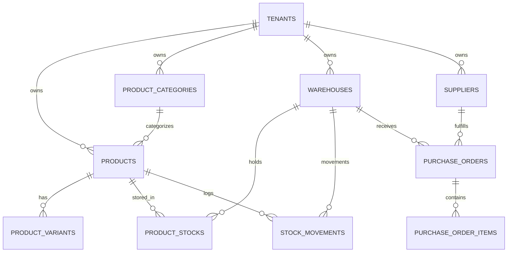

# Product, Service Catalog & Inventory Management Module

## 1. Executive Summary & Capabilities

The **Product, Service Catalog & Inventory Management Module** provides a unified catalog and physical inventory management foundation for the multi-tenant AI CRM SaaS. It connects products and services to CRM deals, quotations, invoices, payments, and sales analytics while enforcing transaction safety and auditability.

### Key Capabilities
1. **Unified Catalog**:
   - Tangible products and intangible services in a single system.
   - Unique SKU codes, brand, UOM units (`pcs`, `kg`, `box`, `hrs`, `month`), category hierarchy, barcodes, and HSN/SAC tax codes.
   - Sale prices, purchase/cost prices, tax rates, and margin tracking.
   - Product variants and attributes (e.g., size, color, RAM/storage configurations).
   - Service-specific attributes: duration (e.g. 10 hours, monthly) and delivery type (`remote`, `on_site`).
2. **Multi-Warehouse Physical Inventory**:
   - Multiple warehouses and storage depots per business workspace.
   - Primary warehouse assignment and opening stock initialization.
   - Separate tracking for `current_stock`, `reserved_stock`, `available_stock` (`current_stock - reserved_stock`), and `damaged_stock`.
   - Minimum stock reorder thresholds with automated low stock notifications.
3. **Pessimistic Locking & Immutable Stock Ledger**:
   - **Golden Rule**: Never updates stock silently without a corresponding stock movement record.
   - Transactional pessimistic locks (`lockForUpdate()`) on stock records during movements to eliminate race conditions under concurrent load.
   - Complete audit trail of movements (`opening_stock`, `purchase_receipt`, `sale_deduction`, `sale_return`, `adjustment_increase`, `adjustment_decrease`, `transfer_out`, `transfer_in`, `damage_writeoff`, `stock_reserved`, `stock_released`) capturing `before_stock`, `after_stock`, `unit_cost`, `total_cost`, user ID, and reference metadata.
   - Configurable tenant-level protection against negative stock.
4. **Inter-Warehouse Stock Transfers**:
   - Transfer stock between source and destination warehouses with dual-entry ledger tracking (`transfer_out` on source, `transfer_in` on destination).
5. **Physical Stock Adjustments**:
   - Reconcile physical inventory discrepancies with reasons, supporting increases, decreases, and damage write-offs.
6. **Suppliers & Procurement Operations**:
   - Supplier/vendor profiles with payment terms and tax IDs.
   - Purchase Orders with line items, tax, discounts, and order status workflow (`draft`, `ordered`, `partially_received`, `received`, `cancelled`).
   - Goods Receipt Notes (GRN) automatically increment warehouse stock and log purchase receipt movements.
7. **Valuation & Analytics Reports**:
   - Current inventory cost valuation vs. retail valuation, and unrealized gross margins.
   - Warehouse-by-warehouse stock and valuation breakdowns.
   - Low stock alert alerts with deficit tracking.

---

## 2. Database Schema & Architecture

### Migrations: `2026_11_23_000007_create_inventory_and_catalog_tables.php`

### Table Definitions

| Table | Primary Columns | Purpose |
|---|---|---|
| `product_categories` | `id`, `tenant_id`, `name`, `slug`, `parent_id`, `description` | Hierarchical catalog categories |
| `products` (enhanced) | `id`, `tenant_id`, `type`, `name`, `sku`, `category_id`, `brand`, `unit`, `price`, `cost_price`, `tax_rate`, `hsn_sac_code`, `barcode`, `track_inventory`, `allow_negative_stock`, `service_duration`, `service_delivery_type`, `status` | Catalog items (products & services) |
| `product_variants` | `id`, `tenant_id`, `product_id`, `name`, `sku`, `attribute_values`, `sale_price`, `cost_price`, `barcode`, `status` | Item variants & attributes |
| `warehouses` | `id`, `tenant_id`, `name`, `code`, `contact_name`, `email`, `phone`, `address`, `city`, `state`, `country`, `is_primary`, `is_active` | Physical storage locations |
| `product_stocks` | `id`, `tenant_id`, `product_id`, `product_variant_id`, `warehouse_id`, `current_stock`, `reserved_stock`, `minimum_stock`, `damaged_stock` | Current balance per warehouse |
| `stock_movements` | `id`, `tenant_id`, `product_id`, `product_variant_id`, `warehouse_id`, `destination_warehouse_id`, `movement_type`, `quantity`, `unit_cost`, `total_cost`, `before_stock`, `after_stock`, `reference_type`, `reference_id`, `user_id`, `notes` | Immutable stock movement ledger |
| `stock_adjustments` | `id`, `tenant_id`, `warehouse_id`, `adjustment_number`, `reason`, `status`, `user_id`, `approved_by` | Physical count adjustment headers |
| `stock_adjustment_items` | `id`, `stock_adjustment_id`, `product_id`, `product_variant_id`, `adjustment_type`, `quantity`, `unit_cost`, `notes` | Line items for adjustments |
| `stock_transfers` | `id`, `tenant_id`, `source_warehouse_id`, `destination_warehouse_id`, `transfer_number`, `status`, `user_id`, `shipped_at`, `received_at` | Warehouse-to-warehouse transfers |
| `stock_transfer_items` | `id`, `stock_transfer_id`, `product_id`, `product_variant_id`, `quantity`, `notes` | Line items for transfers |
| `suppliers` | `id`, `tenant_id`, `name`, `code`, `contact_name`, `email`, `phone`, `address`, `tax_id`, `payment_terms`, `currency`, `status` | Procurement vendors |
| `purchase_orders` | `id`, `tenant_id`, `po_number`, `supplier_id`, `warehouse_id`, `order_date`, `expected_delivery_date`, `status`, `currency`, `subtotal`, `tax_amount`, `discount_amount`, `total_amount`, `user_id`, `received_at` | Procurement purchase orders |
| `purchase_order_items` | `id`, `purchase_order_id`, `product_id`, `product_variant_id`, `quantity`, `received_quantity`, `unit_cost`, `tax_percent`, `total_cost` | Purchase order line items |

---

## 3. Domain Logic & Services

### `InventoryService` (`App\Domains\Inventory\Services\InventoryService`)
- `ensureDefaultWarehouse(int $tenantId): Warehouse`: Ensures each tenant has a primary warehouse ("Main Warehouse", code: `WH-MAIN`).
- `recordStockMovement(array $params, ?User $user = null): StockMovement`:
  - Executes inside a database transaction with `lockForUpdate()`.
  - Enforces negative stock prevention.
  - Updates stock balances (`current_stock`, `reserved_stock`, `damaged_stock`).
  - Writes an immutable record to `stock_movements`.
  - Dispatches low stock in-app notifications if `after_stock <= minimum_stock`.
- `processAdjustment(...)`: Creates `StockAdjustment` with `adjustment_increase`, `adjustment_decrease`, or `damage_writeoff`.
- `processTransfer(...)`: Executes atomic inter-warehouse transfers (`transfer_out` on source, `transfer_in` on destination).
- `getValuationReport(int $tenantId, ?int $warehouseId = null): array`: Calculates inventory cost valuation, retail valuation, unrealized margins, and warehouse metrics.
- `getLowStockAlerts(int $tenantId, ?int $warehouseId = null): Collection`: Identifies items below minimum threshold with deficit calculation.
- `getStockLedger(...)`: Paginated audit ledger filterable by product, warehouse, and movement type.

### `PurchaseService` (`App\Domains\Inventory\Services\PurchaseService`)
- `createPurchaseOrder(...)`: Creates PO with automated code (`PO-YYYYMMDD-XXXX`), calculates item taxes, discounts, and total.
- `receiveGoods(int $tenantId, int $purchaseOrderId, array $receivedItems, ?User $user = null)`:
  - Goods Receipt Note (GRN) workflow.
  - Increments stock via `recordStockMovement` (`movement_type: 'purchase_receipt'`).
  - Sets PO status to `partially_received` or `received`.

---

## 4. API Endpoints

All endpoints are versioned under `/api/v1/crm/` and protected by Sanctum authentication and workspace tenant scoping.

### Catalog
- `GET /api/v1/crm/catalog`: List catalog items with filters (`type`, `category_id`, `status`, `search`).
- `POST /api/v1/crm/catalog`: Create product or service (with optional initial opening stock).
- `GET /api/v1/crm/catalog/{id}`: Single product/service details.
- `PUT /api/v1/crm/catalog/{id}`: Update catalog item.
- `DELETE /api/v1/crm/catalog/{id}`: Soft delete catalog item.
- `GET /api/v1/crm/catalog/categories`: List categories.
- `POST /api/v1/crm/catalog/categories`: Create category.
- `POST /api/v1/crm/catalog/{id}/variants`: Create product variant.

### Inventory
- `GET /api/v1/crm/inventory/warehouses`: List warehouses with SKU counts.
- `POST /api/v1/crm/inventory/warehouses`: Create warehouse.
- `GET /api/v1/crm/inventory/stocks`: List warehouse stock balances.
- `POST /api/v1/crm/inventory/adjust`: Process manual stock adjustment.
- `POST /api/v1/crm/inventory/transfer`: Process inter-warehouse stock transfer.
- `GET /api/v1/crm/inventory/ledger`: Paginated immutable movement ledger.
- `GET /api/v1/crm/inventory/valuation`: Valuation and margin metrics.
- `GET /api/v1/crm/inventory/low-stock`: Low stock alerts and deficits.

### Procurement
- `GET /api/v1/crm/procurement/suppliers`: List suppliers.
- `POST /api/v1/crm/procurement/suppliers`: Create supplier.
- `GET /api/v1/crm/procurement/purchase-orders`: List purchase orders.
- `POST /api/v1/crm/procurement/purchase-orders`: Create purchase order.
- `POST /api/v1/crm/procurement/purchase-orders/{id}/receive`: Goods Receipt Note (GRN).

---

## 5. Frontend Components

| Component | Path | Description |
|---|---|---|
| `ProductCatalogView` | `frontend/src/components/common/ProductCatalogView.tsx` | Main unified catalog and inventory view with 5 tabs (Products, Services, Warehouse Stock, Movement Ledger, Procurement & Suppliers), valuation KPI strip, and modal forms for Items, Adjustments, Transfers, Variants, and Warehouses. |
| `useInventory` | `frontend/src/hooks/useInventory.ts` | React Query hooks managing catalog items, stock balances, adjustments, transfers, ledger, valuation, and procurement. |
| `types.ts` & `client.ts` | `frontend/src/api/` | Strongly typed TypeScript contracts and API methods for catalog, inventory, and procurement. |

---

## 6. Verification & Test Suite

The test suite in `backend/tests/Feature/ProductInventoryModuleTest.php` validates:
1. `product and service creation with opening stock and variants` (PASSED)
2. `stock adjustment increase decrease and damage with ledger` (PASSED)
3. `inter warehouse stock transfer` (PASSED)
4. `procurement purchase order and goods receipt` (PASSED)
5. `low stock alerts and valuation report` (PASSED)
6. `tenant isolation on inventory and procurement` (PASSED)

Full test baseline: **41 passed, 235 assertions** across all CRM modules.
Frontend production build: **Vite 6 build completed in 16.43s** with complete TypeScript type safety.
Frontend integration suite: **8 passed, 0 failed** end-to-end API tests.
