# Product, Inventory, Multi-Warehouse, Procurement and Vendor Management Module

## 1. Executive Summary & Architecture Overview

The **Product, Inventory, Multi-Warehouse, Procurement and Vendor Management Module** delivers an enterprise-grade stock control and supply chain management system tailored for Indian businesses handling physical goods, equipment, spare parts, and merchandise.

Designed with an **optional feature activation architecture**, businesses offering pure digital or professional services can keep the module inactive without interrupting standard CRM, Quotations, and Invoicing flows. Once activated via Subscription or Organization settings, the module provides end-to-end traceability across product variants, multi-warehouse locations, procurement lifecycles, and RMA customer returns.

---

## 2. Key Architectural Modules

```mermaid
flowchart TD
    subgraph ProductsCatalog["1. Product Catalog & Variant Matrix"]
        P1["Product Master (SKU, Barcode, HSN/SAC, Units)"] --> P2["Product Variants & Attributes Schema"]
        P2 --> P3["Stock Availability Engine & Reorder Rules"]
    end

    subgraph MultiWarehouse["2. Multi-Warehouse Stock Tracking"]
        W1["Warehouses & Hubs (Capacity, Branch Link, Manager)"] --> W2["Product Stock (Current, Reserved, Incoming, Damaged)"]
        W2 --> W3["Immutable Stock Movement Ledger"]
    end

    subgraph ProcurementWorkflow["3. 10-Step Procurement Workflow"]
        PR["1. Purchase Request (PR)"] --> PRA["2. PR Approval / Rejection"]
        PRA --> VS["3. Vendor Selection"]
        VS --> PO["4. Purchase Order (PO) Creation"]
        PO --> POA["5. PO Approval & Revisions"]
        POA --> GRN["6. Goods Receipt Note (GRN)"]
        GRN --> QC["7. Quality Check Inspection"]
        QC --> SU["8. Stock Update & Quarantine"]
        SU --> VB["9. Vendor Bill Generation (Finance)"]
        VB --> VP["10. Vendor Payment Tracking"]
    end

    subgraph StockOps["4. Safe Stock Operations"]
        TRF["Inter-Warehouse Transfers (Draft -> Transit -> Receive -> Quarantine)"]
        ADJ["Stock Adjustments & Damage Write-off"]
        REC["Physical Count & Reconciliation"]
        RES["Reservation & Fulfillment Deduction"]
    end

    subgraph SalesAndReturns["5. Sales & RMA Integration"]
        QT["Quotations & Deal Reservations"] --> INV["Tax Invoices & Stock Deduction"]
        RMA["Customer Returns (RMA)"] --> QC2["Condition Inspection"]
        QC2 --> RST["Restock Available OR Quarantine Damaged"]
        RST --> CN["Credit Note Auto-Issuance (Finance)"]
    end

    ProductsCatalog --> MultiWarehouse
    ProcurementWorkflow --> MultiWarehouse
    StockOps --> MultiWarehouse
    SalesAndReturns --> MultiWarehouse
```

---

## 3. Detailed Technical Capabilities

### Step 1: Product Management & Variant Matrix
- **Core Product Fields**: Product ID, Name, SKU, Barcode, Category, Subcategories (`parent_id`), Brand, Description, Primary Unit, Secondary Unit with Conversion Factor, HSN/SAC Code, Tax Rate, Cost Price, Selling Price, Minimum Selling Price guard, Track Inventory toggle, and Active/Archive status.
- **Product Variants**: Multi-attribute matrix (size, color, wattage, model) with auto-generated variant SKUs, separate cost and sale prices, and dedicated barcodes.
- **Data Mobility**: Full CSV Product Export and bulk CSV Product Import with field validation.

### Step 2: Inventory & Real-Time Stock Tracking
- **Granular Stock Types**:
  - `current_stock`: Physical sound stock on hand in the warehouse.
  - `reserved_stock`: Stock allocated to pending orders, quotations, or contracts to prevent double-selling.
  - `available_stock`: Computed dynamically as `max(0, current_stock - reserved_stock)`.
  - `incoming_stock`: Units ordered via open Purchase Orders in transit.
  - `damaged_stock`: Units quarantined due to transit damage, QC rejection, or defect.
  - `returned_stock`: Historical tally of customer returns.
- **Immutable Stock Movement Ledger**:
  - Stock levels are **never** blindly overwritten. Every modification is logged as an immutable `StockMovement` entry recording `movement_type`, before/after stock, unit cost, total valuation, user, reference model, and timestamp.
  - Supported movements: `opening_stock`, `purchase_receipt`, `sale_deduction`, `sale_return`, `adjustment_increase`, `adjustment_decrease`, `transfer_out`, `transfer_in`, `damage_writeoff`, `stock_reserved`, `stock_released`, `stock_reconciliation_adj`, `internal_issue`.
- **Negative Stock Guard**: Prevents stock from dipping below zero unless `allow_negative_stock` is explicitly activated in organization settings.

### Step 3: Multi-Warehouse Management & Transfers
- **Warehouse Profiles**: Name, code, address, manager assignment, storage capacity (sq ft & units), primary hub flag, and optional CRM Branch linkage.
- **Four-Phase Transfer Workflow**:
  1. *Transfer Request (Draft)*: Source and destination selection with line items.
  2. *Approval*: Authorization by warehouse manager or operations lead.
  3. *Dispatch*: Moves transfer to `in_transit`, safely deducting stock from source warehouse with `transfer_out` ledger entry.
  4. *Receipt & Quarantine*: Destination warehouse inspects goods. Sound units are added to available stock (`transfer_in`), while damaged units are quarantined into `damaged_stock` (`damage_writeoff`) without contaminating available inventory.

### Step 4: 10-Step Procurement Workflow
1. **Purchase Request (PR)**: Departmental staff submit requisitions with estimated costs.
2. **PR Approval**: Department head or finance approves or rejects with reason.
3. **Vendor Selection**: Supplier matching from vendor directory.
4. **Purchase Order (PO)**: Generates structured PO with line items, HSN, tax split, and expected delivery date.
5. **PO Approval & Revisions**: Multi-tier approval with audit trail and incremented `revision_number`.
6. **Goods Receipt Note (GRN)**: Gate receiving with challan number and invoice reference. Supports partial receipts.
7. **Quality Check (QC) Inspection**: Line-item breakdown of ordered vs received vs accepted vs rejected/damaged quantities.
8. **Automated Stock Increment**: Only accepted units increment active stock; rejected units are quarantined.
9. **Vendor Bill Generation**: Auto-creates a `VendorBill` in the Accounts Payable ledger, updating vendor outstanding balance.
10. **Vendor Payment Tracking**: Reconciles disbursed payments against outstanding vendor balances.

### Step 5: Vendor & Supplier Management
- **Vendor Profiles**: Company name, contact person, phone, email, registered billing address, GSTIN, PAN.
- **Restricted Bank Details**: Bank name, account number, IFSC, and branch are masked by default (`XXXXXXXXXX4433`) and viewable only by authorized administrators under a secure audit log endpoint (`/api/v1/crm/procurement/suppliers/{id}/bank-details`).
- **Commercial Terms**: Payment terms (Net 15, Net 30, COD, Advance), currency, outstanding balance, and performance rating (1.00 - 5.00).

### Step 6: Physical Stock Count & Reconciliation
- **Periodic Audits**: Creates a `StockReconciliation` audit batch for a warehouse.
- **Variance Analysis**: System quantity vs physically counted quantity calculates unit variance and monetary variance cost.
- **One-Click Stock Adjustment**: Applying reconciliation automatically executes transaction-safe adjustment movements to synchronize system stock with physical reality.

### Step 7: Sales & Invoicing Integration
- **Quotation Line Items**: Link physical products and variants to quotations with real-time stock availability verification (`/api/v1/crm/catalog/check-availability`).
- **Stock Reservation**: Locks stock upon deal win or order placement.
- **Fulfillment & Invoicing**: Deducts physical stock and releases reservation upon invoice finalization or delivery dispatch.

### Step 8: Customer Returns (RMA) & Restock Quarantine
- **RMA Creation**: Customer returns logged with original invoice reference, condition (`unopened`, `opened_good`, `defective`, `damaged_in_transit`), and refund type (`credit_note`, `bank_refund`, `replacement`).
- **QC Inspection & Restock Rules**:
  - Sound items (`restock_available`) are returned to active warehouse inventory via `sale_return`.
  - Damaged items (`quarantine_damage` or `scrap`) are quarantined to damaged stock, **strictly preventing damaged items from returning to available inventory**.
- **Credit Note Integration**: Generates an official GST-compliant `CreditNote` in the Finance module linked to the customer and invoice.

### Step 9: Analytics, Valuation & Profitability Reports
- **Stock Valuation**: Computes inventory asset valuation based on the configured method (**Moving Average**, **FIFO**, or **Standard Cost**).
- **Automated Reorder Report**: Scans for items at or below reorder level, computing suggested reorder quantities and estimated capital requirements.
- **Product Profitability**: Analyzes cost price vs selling price across catalog SKUs, computing gross profit and profit margin percentages.
- **RMA Returns Report**: Tracks return reasons, condition breakdown, and damage rates.

### Step 10: Granular Permissions & Multi-Tenant Scoping
- **RBAC Actions**: Granular permissions for `adjust_stock`, `transfer_stock`, `approve_transfers`, `view_vendor_bank_details`, `view_purchase_costs`, `manage_returns`, and `manage_warehouses`.
- **Row-Level Scopes**: Support for `all`, `branch`, and `warehouse` data scopes.
- **Multi-Tenant Isolation**: Strict workspace boundary enforcement guaranteeing zero leakage of stock, suppliers, or warehouse records across tenants.

---

## 4. Verification & Testing Status

| Test Suite | Tests / Steps | Result | Key Verified Behaviors |
| :--- | :---: | :---: | :--- |
| **PHPUnit Feature Suite** (`AdvancedInventoryProcurementTest.php`) | 10 tests, 54 assertions | **100% Passed** | Feature activation toggle, availability checks, negative stock protection, reservations, transfers with damage quarantine, 10-step procurement workflow, vendor bank masking, physical count reconciliation, RMA credit notes, multi-tenant isolation |
| **Frontend-to-Backend Integration** (`apiIntegration.test.ts`) | Step 62 (62 passed) | **100% Passed** | Settings update, warehouse creation, product stock check, transfer lifecycle, PR approval, PO creation, GRN with QC, vendor bill creation, RMA approval & credit note |
| **Frontend Production Build** | TypeScript + Vite | **0 Errors** | Bundle compiled and chunked cleanly (`dist/`) |
