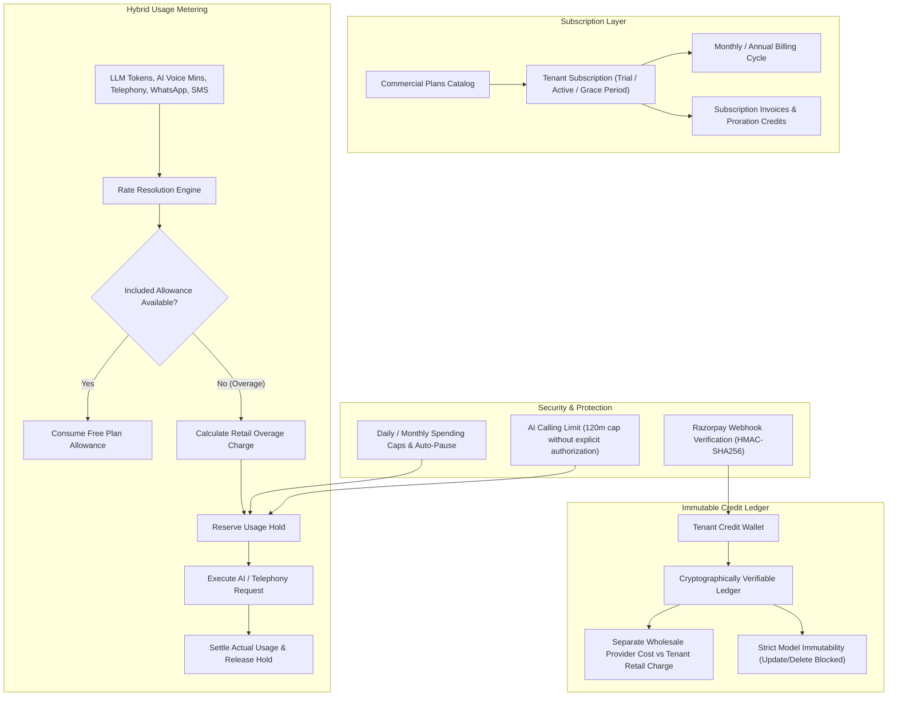

# SaaS Commercial Subscriptions, Hybrid Usage Metering & Immutable Credit Ledger

## 1. Overview & Architecture

The **SaaS Commercial Billing Engine** delivers a comprehensive enterprise monetization framework supporting both fixed recurring subscriptions (Starter, Professional, Enterprise, Custom) and real-time usage-based consumption metering with an immutable credit ledger.

---

## 2. Dynamic Subscription Plans & Limits

All limits and pricing allowances are served dynamically from the backend and configured by Platform Super Admins—**never hardcoded inside frontend components**.

| Feature / Limit | Starter Growth | Professional Scale | Enterprise Elite | Custom Enterprise |
| :--- | :--- | :--- | :--- | :--- |
| **Monthly Price** | \$49.00 / mo | \$149.00 / mo | \$399.00 / mo | Custom Negotiated |
| **Annual Price** | \$490.00 / yr (~17% off) | \$1,490.00 / yr (~17% off) | \$3,990.00 / yr (~17% off) | Custom Negotiated |
| **Team Seats** | 5 Users | 20 Users | Unlimited (500+) | Custom |
| **WhatsApp Numbers**| 1 Number | 3 Numbers | 10 Numbers | Unlimited |
| **AI Agents** | 2 Agents | 10 Agents | Unlimited | Unlimited |
| **Automations** | 10 Workflows | 50 Workflows | Unlimited | Unlimited |
| **API Quota** | 60 RPM | 300 RPM | 1,200 RPM | Custom High-Throughput |
| **Included Tokens** | 250,000 / mo | 2,000,000 / mo | 10,000,000 / mo | Custom |
| **Included AI Voice**| 60 mins / mo | 300 mins / mo | 1,500 mins / mo | Custom |
| **Included WhatsApp**| 1,000 msgs / mo | 5,000 msgs / mo | 25,000 msgs / mo | Custom |

---

## 3. Hybrid Usage Metering Lifecycle

1. **Pre-Authorization & Hold (`reserveUsage`)**:
   - Before executing high-latency or asynchronous AI calls or batch dispatches, the system checks the tenant's remaining allowance and available credit wallet.
   - A cryptographic `usage_reservations` record is created, placing an estimated hold amount on the tenant's wallet.
   - Prevents race conditions and overdrafts when multiple agents run concurrently.
2. **Actual Usage Settlement (`settleUsage`)**:
   - When the upstream provider returns execution metrics (e.g., token usage, call duration in seconds), the actual tenant charge is computed.
   - Unused hold amounts are instantly released back to the wallet balance.
3. **Wholesale Provider Cost vs Retail Tenant Charge Separation**:
   - `UsageRecord` tracks `provider_cost_amount` (COGS: Twilio, Exotel, Google Gemini, OpenAI wholesale costs) separately from `tenant_charge_amount` (retail price billed to the tenant).
   - Enables real-time gross margin and profitability analysis for platform administrators.
4. **Reservation Release on Failure (`releaseReservation`)**:
   - If an AI call is dropped or canceled before connecting, the entire hold is released back to available credits with zero charge.

---

## 4. Immutable Credit Ledger & Mathematical Verification

- **Model-Level Immutability**:
  - `CreditLedgerEntry` registers Eloquent `booted` lifecycle hooks that throw a `RuntimeException` whenever an update or delete operation is attempted.
- **Mathematical Integrity Proof**:
  - The system provides automated verification ensuring that the current credit wallet balance strictly equals the sum of all immutable ledger transactions:
    $$\text{Balance} = \sum_{i=1}^N \text{EntryAmount}_i$$
  - Discrepancies trigger administrative security alerts immediately.

---

## 5. Commercial Billing & Webhook Security

- **Prorated Upgrades & Downgrades**:
  - Upgrading mid-cycle calculates unused days from the current plan and issues a proration credit toward the new tier.
- **Dunning & Grace Period Management**:
  - Failed renewals place the subscription in `grace_period` (7 days standard).
  - In-app warning banners alert users while preserving critical communication and CRM operations.
- **Cryptographic Razorpay Webhooks**:
  - Webhook payloads received at `/api/v1/public/webhooks/razorpay/billing` are verified using HMAC-SHA256 with the platform webhook secret.
  - Idempotent deduplication prevents double-crediting if Razorpay re-transmits duplicate events.
  - Never relies on client-side redirects for payment confirmation.

---

## 6. Cost Protection Guardrails

- **Daily & Monthly Spending Caps**: Hard dollar limits prevent runaway bills from looping automated workflows.
- **AI Provider Limit**: Dedicated spending cap isolating generative AI and LLM token usage.
- **Auto-Pause Control**: Automatically halts billable outbound tasks when caps are reached.
- **AI Voice Calling Guardrail**: Limits single AI calls to 120 minutes unless explicitly authorized by a platform administrator (`is_ai_calling_unlimited_allowed`).

---

## 7. API Reference Summary

| Endpoint | Method | Purpose |
| :--- | :--- | :--- |
| `/api/v1/crm/billing/plans` | `GET` | Retrieve active public commercial plans |
| `/api/v1/crm/billing/subscription` | `GET` | Get current tenant subscription & status |
| `/api/v1/crm/billing/subscription/subscribe` | `POST` | Subscribe, upgrade, or downgrade plan with proration |
| `/api/v1/crm/billing/subscription/cancel` | `POST` | Cancel subscription |
| `/api/v1/crm/billing/subscription/billing-contact` | `PUT` | Update contact info & tax ID (GSTIN/VAT) |
| `/api/v1/crm/billing/invoices` | `GET` | List issued subscription and usage invoices |
| `/api/v1/crm/billing/usage/dashboard` | `GET` | Real-time usage metering dashboard and category limits |
| `/api/v1/crm/billing/usage/reserve` | `POST` | Place usage hold before asynchronous AI/call task |
| `/api/v1/crm/billing/usage/settle` | `POST` | Settle actual usage & release unused hold |
| `/api/v1/crm/billing/usage/release` | `POST` | Release reservation hold on task cancel/failure |
| `/api/v1/crm/billing/wallet` | `GET` | Get credit wallet balance and hold amounts |
| `/api/v1/crm/billing/wallet/recharge` | `POST` | Top-up credit wallet balance |
| `/api/v1/crm/billing/wallet/ledger` | `GET` | View audit trail of immutable ledger entries |
| `/api/v1/crm/billing/wallet/verify-integrity` | `GET` | Mathematical ledger balance integrity check |
| `/api/v1/crm/billing/cost-protection` | `GET/PUT` | Manage daily/monthly spend caps and AI calling guardrails |
| `/api/v1/public/webhooks/razorpay/billing` | `POST` | Verified Razorpay commercial billing webhook |

---

## 8. Verification & Test Suite

1. **Backend PHPUnit Feature Tests**:
   - `SaaSCommercialBillingMeteringTest.php` (8 tests, 57 assertions) — **100% Passed**.
   - Full backend test suite: **166 tests passed (996 assertions), 0 failures**.
2. **Frontend-to-Backend Integration Suite**:
   - `frontend/src/tests/apiIntegration.test.ts` (Step 38 added) — **39/39 steps passed (0 failed)**.
3. **Production Build**:
   - Vite production bundle compiled with **0 errors**.
