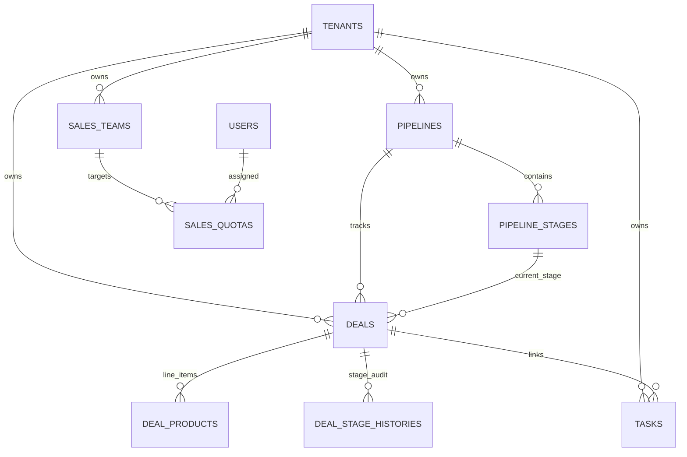

# Sales Pipeline, Deals, Tasks, Follow-ups & Sales Team Management

## 1. Overview & Objectives

The **Sales Pipeline & Sales Team Management Module** provides an enterprise revenue execution engine for the multi-tenant AI CRM SaaS. It connects CRM leads, contacts, and companies directly into structured pipelines, opportunity tracking, daily tasks, reminders, and sales team quotas.

Key capabilities delivered:
1. **Multi-Pipeline Architecture**: Multiple independent sales pipelines per business tenant with customizable stages, ordering, colors, probabilities, and transition validation rules.
2. **Opportunities & Deals**: Contract value, currency, expected close date, weighted forecasting (`value * probability / 100`), linked contacts/companies/leads, products/services line items, stage history tracking, and closure workflows (Won / Lost intelligence).
3. **Tasks & Follow-up Logistics**: Comprehensive task management with hierarchy scoping (My Tasks, Team Tasks, Today, Upcoming, Overdue, Completed), recurring schedules (daily, weekly, monthly), subtask checklists with live toggle, and overdue alerts.
4. **Sales Team Management & Leaderboard**: Structured sales teams with leaders and member rosters, revenue/deal/lead quotas, and real-time performance rankings based on revenue won, quota attainment %, and win rate %.
5. **Productivity Controls**: Automated detection of stale deals exceeding stage duration thresholds, and weighted revenue forecasting broken down by pipeline stage.

---

## 2. Database Schema & Architecture

### Migrations: `2026_11_23_000006_create_sales_pipeline_tables.php`

### Table Definitions

| Table | Primary Columns | Purpose |
|---|---|---|
| `pipelines` | `id`, `tenant_id`, `name`, `description`, `is_default`, `is_active` | Tenant sales pipelines |
| `pipeline_stages` | `id`, `pipeline_id`, `name`, `code`, `probability`, `order_column`, `color`, `is_won`, `is_lost`, `required_fields`, `stale_days_threshold` | Stages within a pipeline with probability and validation |
| `deals` (enhanced) | `pipeline_id`, `pipeline_stage_id`, `currency`, `probability`, `weighted_value`, `stage_updated_at`, `competitor`, `lost_reason`, `collaborator_ids`, `is_archived`, `won_at`, `lost_at` | Opportunity records with forecasting |
| `deal_products` | `id`, `tenant_id`, `deal_id`, `product_id`, `name`, `quantity`, `unit_price`, `total_price`, `discount` | Products/services associated with a deal |
| `deal_stage_histories` | `id`, `tenant_id`, `deal_id`, `pipeline_stage_id`, `stage`, `duration_days`, `changed_by`, `notes` | Audit trail of stage changes and stage residency time |
| `tasks` (enhanced) | `created_by`, `lead_id`, `contact_id`, `company_id`, `deal_id`, `ticket_id`, `start_date`, `reminder_at`, `is_recurring`, `recurring_rule`, `checklist_items`, `completed_at`, `cancelled_at` | Tasks, checklists, and recurring follow-ups |
| `sales_teams` | `id`, `tenant_id`, `name`, `leader_id`, `member_ids`, `description` | Sales teams with supervisor and roster |
| `sales_quotas` | `id`, `tenant_id`, `sales_team_id`, `user_id`, `period`, `start_date`, `end_date`, `target_revenue`, `target_deals_count`, `target_leads_count` | Revenue and activity targets per rep or team |

---

## 3. Domain Logic & Services

### `DealPipelineService` (`App\Domains\CRM\Services\DealPipelineService`)
- `ensureDefaultPipeline(int $tenantId)`: Seeds a 6-stage enterprise pipeline upon tenant onboarding if none exists.
- `moveToStage(Deal $deal, PipelineStage $newStage, array $input, User $user)`:
  - Validates `required_fields` configured on the target stage (e.g., won deals require close date and value; lost deals require `lost_reason`).
  - Automatically sets probability to 100% on won and 0% on lost.
  - Computes `weighted_value = round((value * probability) / 100, 2)`.
  - Records stage duration in previous stage and logs `DealStageHistory`.
  - Emits `CrmActivity` logging stage movement.
- `calculateForecast(int $tenantId, ?int $pipelineId, ?string $startDate, ?string $endDate)`:
  - Aggregates open pipeline value, weighted forecast value, total closed won value, closed lost value, and win rate %.
  - Produces stage-by-stage distribution breakdown.
- `detectStaleDeals(int $tenantId, int $defaultDays = 14)`:
  - Detects open deals exceeding stage threshold residency (`daysInStage >= threshold`), flagging `warning` or `critical` level.

### `SalesTeamService` (`App\Domains\CRM\Services\SalesTeamService`)
- `getLeaderboard(int $tenantId, ?string $period = 'monthly', ?int $teamId = null)`:
  - Computes won revenue, won/lost deals, win rate %, quota attainment %, leads handled, and tasks completed per rep.
  - Dynamically calculates rankings (#1, #2, #3, ...).
- `applyHierarchyScope($query, User $user, int $tenantId, string $assignedUserColumn)`:
  - **Sales Executive**: Scoped strictly to own assigned records.
  - **Manager**: Scoped to all supervised members of their sales team.
  - **Business Owner / Admin / Super Admin**: Unrestricted workspace access.

---

## 4. API Endpoints

All endpoints are versioned under `/api/v1/crm/` and protected by Sanctum token auth and `ResolveActiveTenant` middleware.

### Pipelines & Stages
- `GET /api/v1/crm/pipelines`: List tenant pipelines with stages.
- `POST /api/v1/crm/pipelines`: Create a new pipeline.
- `GET /api/v1/crm/pipelines/{id}`: Pipeline details.
- `PUT /api/v1/crm/pipelines/{id}`: Update pipeline.
- `DELETE /api/v1/crm/pipelines/{id}`: Delete pipeline.
- `POST /api/v1/crm/pipelines/{pipelineId}/stages`: Create stage in pipeline.
- `PUT /api/v1/crm/pipelines/stages/{stageId}`: Update stage properties.
- `DELETE /api/v1/crm/pipelines/stages/{stageId}`: Remove stage.

### Deals & Forecasting
- `POST /api/v1/crm/deals/{dealId}/move-stage`: Transition deal stage with validation.
- `POST /api/v1/crm/deals/{dealId}/products`: Add line item to deal.
- `DELETE /api/v1/crm/deals/{dealId}/products/{productId}`: Remove line item.
- `GET /api/v1/crm/deals/forecast`: Weighted forecast summary and stage breakdown.
- `GET /api/v1/crm/deals/stale`: Stale deals exceeding duration threshold.
- `POST /api/v1/crm/deals/{dealId}/archive`: Archive deal.
- `POST /api/v1/crm/deals/{dealId}/unarchive`: Restore archived deal.

### Tasks & Follow-ups
- `GET /api/v1/crm/tasks`: List tasks with view filters (`my_tasks`, `team_tasks`, `today`, `upcoming`, `overdue`, `completed`).
- `POST /api/v1/crm/tasks`: Create task with recurrence and subtask checklist.
- `PUT /api/v1/crm/tasks/{id}`: Update task.
- `DELETE /api/v1/crm/tasks/{id}`: Delete task.
- `POST /api/v1/crm/tasks/{id}/complete`: Mark task complete.
- `POST /api/v1/crm/tasks/{taskId}/checklist/{itemId}/toggle`: Toggle subtask item.

### Sales Teams & Quotas
- `GET /api/v1/crm/sales-teams`: List sales teams.
- `POST /api/v1/crm/sales-teams`: Create sales team.
- `PUT /api/v1/crm/sales-teams/{id}`: Update team.
- `DELETE /api/v1/crm/sales-teams/{id}`: Delete team.
- `GET /api/v1/crm/sales-teams/leaderboard`: Performance leaderboard and attainment rankings.
- `GET /api/v1/crm/sales-teams/quotas`: List quotas.
- `POST /api/v1/crm/sales-teams/quotas`: Save quota target for rep/team.

---

## 5. Frontend Components

| Component | File Path | Description |
|---|---|---|
| `DealKanbanBoard` | `frontend/src/components/common/DealKanbanBoard.tsx` | Drag-and-drop / stage advancement Kanban with probability headers, weighted pipeline metrics, stale indicators, and close modal. |
| `DealDetailsDrawer` | `frontend/src/components/common/DealDetailsDrawer.tsx` | Slide-out drawer with Overview, Product Line Items editor, Stage History timeline, and linked Activities/Tasks. |
| `TasksManagerView` | `frontend/src/components/common/TasksManagerView.tsx` | Task management with 6 filtered view tabs (My Tasks, Team Tasks, Today, Upcoming, Overdue, Completed), recurring schedules, and interactive checklist toggles. |
| `SalesTeamLeaderboardView` | `frontend/src/components/common/SalesTeamLeaderboardView.tsx` | Sales team performance dashboard with period switcher, KPI cards, rep ranking table with quota attainment progress bars, and quota/team creation modals. |

---

## 6. Test Suite & Verification

The test suite in `backend/tests/Feature/SalesPipelineModuleTest.php` validates:
1. `multiple pipelines and custom stages creation` (PASSED)
2. `deal stage transition validation and weighted probability` (PASSED)
3. `deal closure workflows won and lost` (PASSED)
4. `tasks creation recurrence and views scoping` (PASSED)
5. `sales teams quotas and leaderboard` (PASSED)
6. `stale deals detection and weighted forecast` (PASSED)
7. `tenant isolation on sales pipeline and tasks` (PASSED)

Overall test baseline: **35 passed, 188 assertions** across all CRM modules with 0 regressions.
Frontend production build: **Vite 6 build passed in 15.48s** with complete TypeScript type safety.
