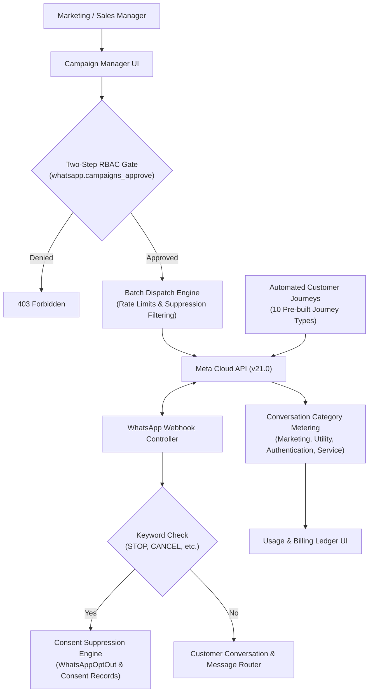

# Advanced WhatsApp Business Platform Integration (Prompt 34)

## Architecture Overview

The Advanced WhatsApp Business Platform integration connects the Enterprise CRM SaaS directly to the **official Meta Cloud API (Graph API v21.0)**. It replaces legacy unofficial scraping and provides a comprehensive enterprise communication, campaign, template, automation, and billing platform.

---

## 1. Meta WhatsApp Connection & Multi-Number Management

- **Database Architecture**:
  - `whatsapp_accounts`: Multi-tenant WABA credentials, App ID, System User Tokens, webhook verify tokens, and connectivity state.
  - `whatsapp_phone_numbers`: Dedicated phone lines registered with Meta Graph API.
- **Fields Added**:
  - `branch_id` and `department_id`: Line-level routing to specific branches or support/sales desks.
  - `messaging_limit_tier`: Enforcing Meta's daily recipient tiers (`TIER_250`, `TIER_1K`, `TIER_10K`, `TIER_100K`, `TIER_UNLIMITED`).
  - `quality_rating`: Live status tracking (`GREEN`, `YELLOW`, `RED`, `UNKNOWN`).
  - `working_hours_start` & `working_hours_end`: Departmental business hours.
  - `auto_reply_outside_hours` & `outside_hours_message`: Automated off-hours responders.
  - `connectivity_status`: Verified live with `pingTest()` against Meta Graph API.

---

## 2. Template Management & Graph API Synchronization

- **Template Categories**:
  - `MARKETING`: Promotional broadcasts, discounts, new product releases.
  - `UTILITY`: Order updates, invoices, account alerts, appointment confirmations.
  - `AUTHENTICATION`: OTPs and verification codes.
- **Key Features**:
  - Automatic synchronization from Meta WhatsApp Business Account.
  - Variable schema mapping (`{{1}}`, `{{2}}`, `{{3}}` placeholders mapped to CRM lead attributes).
  - Test message dispatch tool for administrators to inspect live WhatsApp rendering before broadcasting.
  - Live analytics per template: Total sent, delivered, read, and conversion rates.

---

## 3. Bulk Campaign Manager & 2-Step RBAC Approval Gate

- **Audience Ingestion**:
  - CRM Segments: Filter by tags, lead stage, score, or geography.
  - Contact Selection: Direct multi-select from CRM customer database.
  - CSV Import: Drag-and-drop CSV files with column mapping, phone normalization to E.164, and duplicate removal.
- **Compliance & Opt-Out Suppression List**:
  - Any phone number on the tenant's `WhatsAppOptOut` suppression list is automatically marked `skipped_opt_out` and omitted from outbound dispatch.
- **Two-Step Authorization Approval Workflow**:
  - Sales agents and campaign creators can draft campaigns and submit them for review (`pending_approval`).
  - Only managers or administrators with the explicit `whatsapp.campaigns_approve` permission or `Admin`/`Owner` roles can authorize campaigns.
  - Unauthorized approval attempts return `403 Forbidden`.
- **Batch Processing & Funnel Analytics**:
  - Batching engine processes messages in slices complying with provider rate limits.
  - Real-time funnel metrics: `queued`, `sent`, `delivered`, `read`, `failed`, `skipped_opt_out`, and delivery rate %.

---

## 4. Automated Customer Journeys

The journey automation engine supports **10 pre-built enterprise triggers**:
1. `new_enquiry_welcome`: Instant welcome greeting upon new lead capture.
2. `lead_qualification`: Automated qualification questions after initial enquiry.
3. `appointment_confirmation`: Meeting/demo confirmation alerts.
4. `payment_reminder`: Overdue invoice alerts with payment links.
5. `invoice_reminder`: Upcoming invoice payment due notifications.
6. `renewal_reminder`: Subscription or contract renewal warnings.
7. `customer_onboarding`: Step-by-step product walkthroughs for new customers.
8. `service_update`: System maintenance or policy updates.
9. `sales_followup`: Automatic re-engagement after sending a proposal or quotation.
10. `abandoned_enquiry`: Re-targeting dropped leads after 48 hours of inactivity.

- **Dynamic Execution**:
  - Configurable delays (e.g. 15 minutes, 1 day).
  - Stop conditions: Automatically halted if customer replies (`customer_replied`) or if the lead stage advances to `won`.
  - Full execution audit trail stored in `whatsapp_automation_logs`.

---

## 5. 24-Hour Customer Service Window & Opt-Out Handling

- **24-Hour Window Enforcement**:
  - Free-form text and media messages can only be sent within 24 hours of the customer's last inbound message (`window_expires_at`).
  - When the window has expired, the CRM UI restricts the composer to pre-approved Meta message templates.
- **Automated Opt-Out Compliance**:
  - When a customer sends `STOP`, `UNSUBSCRIBE`, `CANCEL`, `QUIT`, `ARRET`, or `ROKHO`, the webhook engine automatically:
    1. Registers the number in `whatsapp_opt_outs`.
    2. Updates `customer_communication_consents` to `opted_out`.
    3. Emits an internal compliance notice in the conversation thread.

---

## 6. Conversation-Based Usage & Billing Ledger

- **Meta Conversation Categories Tracked**:
  - `marketing`, `utility`, `authentication`, `service`.
- **Usage Metrics & Summary**:
  - Aggregated daily/monthly costs incurred.
  - Breakdown by phone number, campaign, and message category.
  - Itemized ledger records stored in `whatsapp_usage_records`.

---

## 7. Frontend User Interface

The WhatsApp CRM module (`frontend/src/components/common/WhatsAppInboxView.tsx`) now contains a unified top navigation bar switching between:
1. **Customer Inbox**: Split-pane omnichannel conversation view, 24h window badge, quick replies, AI toggle, and lead conversion.
2. **Campaigns**: Audience selector, CSV upload, 2-step approval button, live funnel metrics, and batch controls.
3. **Automated Journeys**: 10 journey cards, trigger configuration, toggle switches, and execution logs.
4. **Templates**: Template sync button, category filters, placeholder inspector, and test message modal.
5. **Phone Lines & Routing**: Multi-number roster, branch/dept mapping, messaging limit tiers, and working hours schedule.
6. **Usage & Billing**: Metric cards (total cost, marketing/utility/auth spend), date filters, and ledger table.

---

## 8. Verification Results

- **Backend Feature Test Suite**:
  - File: [WhatsAppEnterprisePlatformTest.php](file:///c:/xampp/htdocs/crm-enterprises/backend/tests/Feature/WhatsAppEnterprisePlatformTest.php)
  - Results: **10 passed (54 assertions, 100% green)** in 2.87s.
- **Frontend Integration Test Suite**:
  - File: [apiIntegration.test.ts](file:///c:/xampp/htdocs/crm-enterprises/frontend/src/tests/apiIntegration.test.ts)
  - Step 48: Advanced WhatsApp Business Platform (Accounts, Lines, Sync, Campaigns, Automations & Billing)
  - Results: **49 passed, 0 failed (100% green)**.
- **Production Build**:
  - Command: `cd frontend; npm run build`
  - Result: 0 TypeScript compile errors, production bundle generated cleanly.
